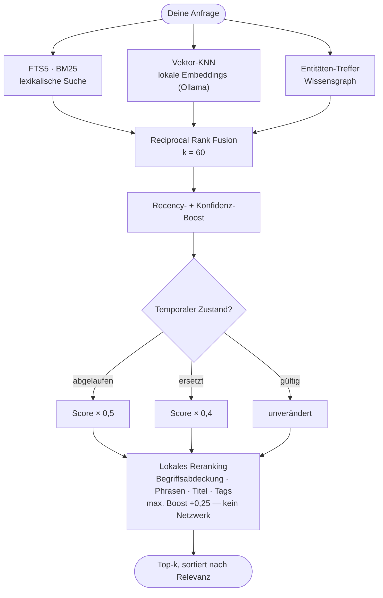

<p align="center"></p>
<p align="center">   <a href="https://www.linkedin.com/in/damian-todorovic-244235434"></a></p>

# KEPTA — das Gedächtnis für KI-Systeme (deutsches Readme)

Deine KI vergisst alles. Jeder Chat beginnt bei null.

KEPTA ändert das — **lokal**. Eine verschlüsselte SQLite-Datei auf deinem Rechner, die **jede** KI liest und schreibt: Claude Desktop, Cursor, Gemini CLI, Cline, jeder MCP-Client — und Skripte über eine kleine **HTTP-API**. Keine Cloud, kein Konto, keine Telemetrie. Eine Datei, die dir gehört.

> **Dies ist der source-available Kern** (BUSL-1.1 — jede Zeile öffentlich, aber kein OSI-zertifiziertes Open Source; Übergang in AGPL-3.0-or-later vier Jahre nach jedem Release): Memory-Engine, MCP-Server, HTTP-API — dazu der Python-Client unter MIT, damit ihn jedes Python-Projekt einbauen kann. **Alles, was das Gedächtnis klüger macht, liegt in dieser Engine — gratis, ohne Lizenzschritt, und innerhalb des Gedächtnisses gibt es keine Stufen, nichts wird zurückgehalten, um etwas zu verkaufen.** Eine Kapazitätsgrenze gibt es trotzdem, und sie ist keine Bezahlsperre: die lokale API nimmt neue Notizen bis `KEPTA_MAX_ACTIVE` (Standard 5000) an — zu finden bei den [Schrauben](#-schrauben). English: [README.md](README.md).

Fragen, Security-Feedback oder Benchmark-Kritik? → **[Discussions](https://github.com/DamianTodorovic/kepta/discussions)**

## ⚡ Ein Befehl, jeder KI-Client

Braucht **Node 22.13 oder neuer** (`package.json` → `engines`) auf dem Rechner, den du installierst; fertige SQLite-Binaries decken Node 22, 24 und 26 ab.

```bash
npx -y kepta-mcp demo          # sechs Szenen in einer Wegwerf-Datenbank — deine Daten bleiben unangetastet
npx -y kepta-mcp setup         # verbindet Claude Desktop, Claude Code, Cursor, Windsurf, VS Code, Gemini CLI, Cline und Roo Code
npx -y kepta-mcp remember "Kunde Miller unterschreibt Verlängerungen im Dezember."   # eine Notiz direkt aus dem Terminal, ohne KI-Client
npx -y kepta-mcp recall "wer unterschreibt verlängerungen"                             # und zurück: 1 Treffer — sortiert nach Relevanz
npx -y kepta-mcp stats         # Größe und Verschlüsselungszustand des Gedächtnisses
npx -y kepta-mcp timeline "miller"                                      # was wann galt
npx -y kepta-mcp import chatgpt <export-ordner>   # bring deine ChatGPT-Historie mit (Export → entpacken → import)
```

Eine **Notiz** ist ein Ding, das dein Gedächtnis hält — `remember` schreibt sie von Hand, dein KI-Client schreibt dieselbe Art über das Werkzeug `memory_save`. Dann sag deiner KI etwas, das sie behalten soll — und sieh zu, wie es ankommt. Mehr im [Schnellstart](#-schnellstart).

## 🖥️ Oder lad die Desktop-App

**Der Kern hat keine eigene Oberfläche: seine Oberfläche ist dein KI-Client.** Wer ein Fenster will, nimmt die kostenlose Desktop-App — dieselbe Engine, dieselbe verschlüsselte Datei, derselbe Schlüssel — und die liegt in den Releases dieses Repos. Für Teams und Organisationen gibt es KEPTA Enterprise nach Absprache. Dieser Dreisatz ist die ganze Antwort, und jedes Dokument hier sagt dasselbe.

Die App bringt Memory-Browser, Hybridsuche mit Spuren-Herkunft, Wissensgraph, Zeitreise, Dossiers und einen Chat, der das Gedächtnis liest. Die DMG für deinen Mac liegt im [neuesten Release](https://github.com/DamianTodorovic/kepta/releases/latest) (Apple Silicon oder Intel), reinziehen in „Programme". Die Builds sind ad-hoc signiert und nicht notarisiert, macOS fragt also ein einziges Mal. Zwei Wege, die auf jeder macOS-Version funktionieren: `xattr -dr com.apple.quarantine /Applications/KEPTA.app`, oder *Systemeinstellungen → Datenschutz & Sicherheit* → die KEPTA-Meldung → **Dennoch öffnen**. Einmal, dann nie wieder. Ältere Anleitungen empfehlen Rechtsklick → **Öffnen** — Apple hat diesen Weg mit macOS 15 entfernt, er tut auf aktuellen Systemen nichts. (Was aus diesem Repository läuft, hat kein Fenster: `npm run dev` startet die HTTP-API und ihr `POST /mcp` — ein Dienst auf deinem Rechner, keine Oberfläche.)

Die App ist gratis wie alles in diesem Repository. KEPTA Enterprise (Team- und Mandanten-Gedächtnis, Audit-Kette, Menschenschleuse, Point-in-Time-Recovery) wird nach Absprache lizenziert — [schreib mir auf LinkedIn](https://www.linkedin.com/in/damian-todorovic-244235434).

## 🧠 Eine Engine. Frei. Für jede KI.

KEPTA ist kein Feature in einer App — es ist eine Gedächtnis-Schicht, die jedes Modell, jede App und jedes Kontextfenster überlebt. Drei Türen führen in dieselbe verschlüsselte Datei:

| Tür | Wer sie nutzt |
|---|---|
| **MCP** — 8 Tools, stdio (npm-Bin und Container) + Streamable HTTP (dieses Repo, aus dem Quelltext gestartet) | Jeder MCP-Client: Claude, Cursor, Gemini CLI, Cline, Codex, Zed, deine eigenen Agenten |
| **HTTP-API** — 32 Routen, nur Loopback | Skripte, Cron-Jobs, Agenten-Teams, Automatisierungen |
| **Python** — `pip install kepta`, nur Standardbibliothek | Jedes Python-Projekt, eingebettet |

**Frei heißt frei:** 0 €, für immer — kein Konto, kein Lizenzschlüssel, kein Tageslimit, keine Stufe innerhalb des Gedächtnisses, nichts gesperrt, um es später zu verkaufen. Die beste Memory-Engine, die wir bauen können, ist die freie; genau das ist der Punkt. Dieser Satz handelt von Geld, nicht von Kapazität: auf einer Maschine stoppt die lokale API neue Notizen, sobald `KEPTA_MAX_ACTIVE` Notizen aktiv sind (Standard **5000**, `server.ts` → `maxActiveMemories()`) — eine Bremse für einen davonlaufenden Agenten, keine Bezahlsperre. Hochsetzen: diese eine Variable, sonst ändert sich nichts. Nachlesen: [SECURITY.md](SECURITY.md#environment-variables).

**Teams und Organisationen** — Team-Gedächtnis, zentrale Richtlinien, MDM, organisationsweites Audit — bekommen **KEPTA Enterprise auf Anfrage**. Koordination ist das Einzige, was wir je berechnen; Gedächtnisqualität nie. → [schreib mir auf LinkedIn](https://www.linkedin.com/in/damian-todorovic-244235434)

## ⚡ Schnellstart

**1. Mit deinen KI-Apps verbinden:** `npx -y kepta-mcp setup` findet Claude Desktop, Claude Code, Cursor, Windsurf, VS Code, Gemini CLI, Cline und Roo Code und trägt KEPTA dort ein — es fragt je App (`--yes` verbindet alle), sichert jede Datei, die es ändert, und lässt alle anderen Einträge stehen. Für Zed, Codex CLI und Continue gibt es den Einfüge-Schnipsel im englischen [README.md](README.md#connect-your-ai-apps) (deren Konfigurationsformate ändern sich zu schnell, um sie von außen zu schreiben). Jeder andere MCP-Client:

```json
{
  "mcpServers": {
    "kepta": {
      "command": "npx",
      "args": ["-y", "kepta-mcp"]
    }
  }
}
```

Deine KI bekommt damit **acht Werkzeuge**: `memory_search`, `memory_save`, `memory_update`, `memory_delete`, `memory_list`, `memory_graph`, `memory_consolidate`, `memory_forget`.

**2. HTTP-API:**

```bash
git clone https://github.com/DamianTodorovic/kepta.git
cd kepta && npm install && npm run dev
# → http://127.0.0.1:3000

# eine Notiz speichern
curl -s localhost:3000/api/memory -H 'Content-Type: application/json' \
  -d '{"title":"Kunde Miller","content":"Rechnet quartalsweise ab.","tags":["kunde"]}'

# und suchen
curl -s "localhost:3000/api/memories/search?q=wie+rechnet+miller+ab"
```

Die HTTP-API und ihr `POST /mcp` laufen aus diesem Repo (`npm run dev`). Das npm-Paket und der Container sprechen MCP über **stdio**.

**3. Docker** (nur MCP-Server) — aus einem **sauberen Klon, vor jedem `npm install`**: ein für macOS gebautes `node_modules` im Baukontext bricht den Linux-Bau (`ERR_DLOPEN_FAILED`). Am 09.10.2026 so gemessen: derselbe Befehl schlägt mit 189 MB Baukontext fehl und gelingt mit 19 MB aus dem frischen Klon. (Eine `.dockerignore` hält `node_modules` und Bauartefekte jetzt draussen — bis die in deinem Checkout liegt, ist der saubere Klon der sichere Weg.)

```bash
git clone https://github.com/DamianTodorovic/kepta.git && cd kepta
docker build -t kepta-mcp .

# Ein Container hat keinen Schlüsselbund, der Schlüssel muss aus der Umgebung.
# Einmal erzeugen und aufheben — er ist der einzige Weg zurück in das Volume.
KEPTA_DB_KEY=$(openssl rand -hex 32)

docker run --rm -i -e KEPTA_DB_KEY="$KEPTA_DB_KEY" -v kepta-data:/data kepta-mcp
```

**Ohne Schlüssel keine Datei.** Der Wert ist Bedingung, nicht Empfehlung: 64 Hex-Zeichen, einmal erzeugt mit `openssl rand -hex 32` und aufgehoben wie ein Passwort. Ein Container hat keinen Schlüsselbund, also kann eine **neue** Wissensbasis ohne `KEPTA_DB_KEY` nicht entstehen — KEPTA bricht dann mit Exit ungleich 0 ab und nennt den Ausweg. Beim Start immer **denselben** Wert übergeben: ein neues `openssl rand -hex 32` beim zweiten Lauf ist ein Schlüssel, der nicht zu dem Volume passt, und auch dann bleibt die Datei unverändert. Der einzige Weg zu einer Klartext-Datei ist der Schalter, der das laut sagt: `KEPTA_ENCRYPTION=off`.

Für alle, die diesen Text gegen eine ältere Fassung lesen: **vor** dieser Regel hat ein unbrauchbarer Wert (Platzhalter mitkopiert, zu kurz, kein Hex) KEPTA nicht gestoppt — eine Zeile „NOT encrypted", die Datenbank **im Klartext**, Exit-Code 0. Beginnt deine `kepta.db` mit den Bytes `SQLite format 3`, ist genau das passiert, und die Datei ist für jede Leserin offen. Erst Fassung dieser Regel ist der Stand vom 10.10.2026, der Code wird gerade umgestellt — wer eine ältere Ausgabe fährt, prüft sie statt sich auf diesen Satz zu verlassen. [SECURITY.md](SECURITY.md#encryption-at-rest) sagt die ganze Regel.

**CI und Server haben keinen Schlüsselbund.** Der Schlüssel kommt als Secret in die Pipeline, einmal erzeugt — nicht je Lauf neu, sonst startet jeder Lauf ein leeres Gedächtnis:

```yaml
# GitHub Actions, ein Schritt. Das Secret hält die 64 Hex-Zeichen aus `openssl rand -hex 32`.
- run: KEPTA_DB_KEY="${{ secrets.KEPTA_DB_KEY }}" npx -y kepta-mcp stats
```

Drei Fallen, am Baum gemessen: Ein **leerer** Wert ist kein „ohne Schlüssel" — `KEPTA_DB_KEY=""` verwirft KEPTA und fragt den Schlüsselbund des Rechners, du liest also den Eintrag, den du gerade nicht anfassen wolltest (`src/core/schluessel.ts`). Ein **Platzhalter** ist auch ein Wert. Und ein Schlüssel, der in einer protokollierten Befehlszeile steht, ist ein **veröffentlichter** Schlüssel. Wenn der Lauf keinen Schlüssel erreicht, ist das richtige Ergebnis das von oben: keine Datenbank, Exit ungleich 0, ein Satz mit `KEPTA_DB_KEY`. Ein grüner CI-Lauf, der eine Klartext-Wissensbasis gebaut hat, ist genau der Fehler, den diese Regel schließt.

**Zahlen:** **1024 Tests** (gemessen am 2026-10-12) · 32 Routen · `npm run eval` — Eval auf 58 Notizen / 45 Anfragen (Hit@1, Recall@5 gekappt, MRR). Die Testzahl ist die Zahl der Fälle, die ein Lauf gesammelt hat und ausführen konnte: ein im Quelltext als `it.skip` geschriebener Fall geht von ihr ab, ein Fall, den die **Ruhe-Sonde während des Laufs abgewiesen hat**, bleibt darin — derselbe Baum auf demselben Rechner ist so oder so dieselbe Zahl (`scripts/test-bericht.mjs` begründet es an diesem Rechner: an einem Commit wiesen drei Zeit-Fälle die Ruhe ab, am nächsten liefen sie, und eine Zahl, die mit der Nachbarschaft läuft, ist keine Zahl). `npm test` schreibt den Bericht genau dieses Laufs, `node scripts/doku-check.mjs` hält beide READMEs auf dieser Zahl fest, und `tests/doku-zahlen.test.ts` hört auf denselben Bericht: fehlt er, ist er älter als die Suite oder stammt er aus einem Teillauf, meldet die Wache, dass sie nicht prüfen kann, statt still einen Wert aus der Ablage zu vergleichen.

## 🔍 Wie eine Anfrage ihre Antwort findet



**Was jedes Bein allein trägt** — `npx tsx scripts/ablation.ts` auf diesem Stand, 58 Notizen / 45 Anfragen, lokales Ollama, am 09.10.2026 nachgemessen: Hit@1 mit **nur Volltext 71 %**, Volltext **+ Graph 71 %** (+0 Prozentpunkte), Volltext **+ Vektoren 78 %**, **alle drei 78 %**; das Graph-Bein allein kommt auf 11 %. Das heißt ehrlich gelesen: die Wortspur trägt die Antwort, die Vektor-Spur sind die sieben Punkte zusätzlich und das einzige Bein, das ein Modell braucht — und auf diesem Korpus verschiebt das Graph-Bein die Rangfolge nicht. Es ist für Begriffe und für `GET /api/graph` da, nicht für den Sieg. Drei gleich starke Beine zu behaupten hieße, eine Zahl zu verkaufen, der das hauseigene Skript widerspricht.

## 🔌 Die API und was sie vor dem Zerstören fragt

Fünf Verhaltensweisen, die ein Skript kennen muss — jede einzelne ist dazugekommen, weil der alte Default schon bei einem Tippfehler Daten gekostet hat:

- **`POST /api/memories/import` mit `mode:"replace"` braucht `confirm:"replace"`.** Ohne das antwortet der Kern `400`, und es passiert nichts — vorher nahm ein einzeiliger Aufruf die ganze Wissensbasis endgültig. Vor dem Leeren schreibt der Kern eine verschlüsselte Sicherung nach `<datenordner>/backup/kepta-pre-replace-<zeitstempel>.db` und nennt sie in der Antwort als `backupPath`. `dryRun: true` zeigt vorher `affected: {active, trashed}` und ändert nichts. Eine Nutzlast ohne einzige nutzbare Notiz (leeres Array, Notizen ohne Inhalt) wird mit `400` abgelehnt — das war der Fall, der alles löschte. Zurückholen: die `.db` in einen leeren Datenordner als `kepta.db` legen und mit demselben Schlüssel starten. Die Sicherungen bleiben liegen, eine je bestätigtem Volltausch — Aufräumen von `backup/` ist Aufgabe des Betreibers.
- **`DELETE /api/memories/:id?permanent=` ist streng.** Nur `1`, `0`, `true`, `false` oder ganz weg (= Papierkorb). Alles andere, auch `True`, sind `400` und löschen nichts; `?permanent=1&permanent=0` ebenfalls.
- **`GET /api/settings` nennt keine Geheimnisse mehr.** Schlüssel, die auf `key`, `api_key`, `token`, `secret`, `password`, `passwort`, `passphrase` oder `schluessel` enden, und der Blob `ai_settings` kommen als `{gesetzt: true, ende: "…letzte vier Zeichen…"}` zurück; unter acht Zeichen gibt es kein `ende`, ein gelöschter Eintrag fehlt ganz. Geschrieben wird weiter über `PUT`, der volle Wert bleibt in der verschlüsselten Datenbank. In jeder Oberfläche: `gesetzt` + `ende` anzeigen, nie den Wert.
- **Fehlerantworten sind JSON.** Kein Stapelverweis, kein absoluter Pfad, kein Zurückwerfen des gesandten Body. `413` nennt Grenze und angelangte Menge (`limitBytes`, `receivedBytes`), kaputtes Body-Material bekommt ein `400` ohne Echo, und ab `500` steht der wahre Grund im Serverprotokoll statt in der Antwort.
- **`POST /api/repair/imports` nimmt 16 KB an.** Die Grenze war vorher deklariert, aber wirkungslos (900 KB sind durchgegangen); alles größere endet jetzt mit `413`. Sonst hat sich an der Route nichts geändert.

Zwei kleinere, die je eine Zeile wert sind: Ein **Symlink in `~/.kepta/inbox/` wird nicht importiert** — er bleibt liegen, und `POST /api/inbox/scan` meldet ihn in `skipped: [{file, reason}]` (ein Link hat gereicht, um jede lesbare Datei deines Rechners in den KI-sichtbaren Speicher zu saugen). Und **`GET /api/graph` ist gekappt**: höchstens 500 Begriffe und 2000 Beziehungen (`src/core/store.ts`, `getGraph()`), ohne `ORDER BY` vor beiden Kappen — welche Einträge ankommen, entscheidet die Zeilenordnung und nicht die Bedeutung, also kann in einem großen Bestand ein zentraler Begriff fehlen. Was die Kanten **nicht** mitbringen: die Beziehungen tragen die Felder `validFrom` und `validTo`, aber der Schreibweg des Kerns lässt beide leer (`addRelation` wird ohne Fenster aufgerufen, also steht der Default `null`), ein Client kann aus Kern-Daten also nie „abgelaufene Behauptung" zeichnen — und darf so tun, als könnte er es nicht.

### GET /api/graph/bild — die Fläche, die sagt, was sie weggelassen hat

`GET /api/graph` bleibt, wie es ist, weil fremde Agenten auf seine Form schreiben. Der Bild-Pfad ist der ehrliche Bruder: Er antwortet im Vertrag `graf-2` mit `sicht`, `entitaet`, `tiefe`, `knoten`, `kanten`, `layout` — und **ohne** `width`/`height`, absichtlich. Plätze kommen in **Welteinheiten**, und `welt.groesse` ist die Seite DIESES Bildes — ein Anker von 1000, mit dem Bestand wachsend, von den Kräften gerechnet und in jeder Antwort gemeldet (`src/core/graf-vertrag.ts`). `welt.nullpunkt` ist die untere linke Ecke dieser Welt: seit Layout-Stand 5 liegt ein Platz in `nullpunkt + [0, welt.groesse]` auf jeder Achse und startet **nicht** garantiert bei 0 — eine zusaetzliche Notiz kann ueber den Untergrund des vorigen Bildes hinauswachsen, waehrend jeder bitgleich verankerte Knoten exakt an seinem Platz bleibt, und eine Verschiebung, die eine schoene Null ergibt, wuerde sie alle bewegen. Der Client rechnet also `(x - welt.nullpunkt.x) / welt.groesse` und skaliert ueber `min(breite, hoehe)`, damit keine Fenstergröße in eine Layout-Rechnung gerät. Durch eine eingebaute 1000 zu teilen — oder einen Untergrund von 0 anzunehmen — ist das Einzige, was ein Renderer nicht tun darf: bei 3 000 Noten ist die Welt ~2 500 Einheiten breit, und das Bild läge als Fünftel-Cloud in leerer Fläche. Was er gerechnet hat, ist nicht das, was er zeigt — und die Antwort sagt das selbst in `kuerzung`: die Kappen, die er gehalten hat, was übrig ist (`uebrig`), **warum** er gekappt hat (`grund`: `knoten`, `kanten`, `paarBudget`, `tiefe`, `privat`, `papierkorb`), wie viele private und papierkorb-behaftete Träger herausgefiltert wurden — Zahlen, nie Namen — welche Knoten und Kanten verwaist sind, und ein einziges Flag `vollstaendig`. ETag und `If-None-Match` geben die `304`, ohne neu zu rechnen. Wer wissen muss, ob das Bild der ganze Bestand ist, lies dieses Feld; `GET /api/graph` sagt es nicht.

**Der Kern trennt seine eigenen Scheiben jetzt** (`LAYOUT_VERSION` 5). Ein Bestand wird layoutschonend so gelegt, dass sich keine zwei Knotenscheiben überschneiden, bevor irgendetwas gezeichnet wird — gemessen an 400 / 1 500 / 3 000 Knoten an 27 Begriffen: **0 schneidende Paare**, gezählt sowohl nach der ungedeckelten Regel des Kerns `r = 6 + 2,4·√grad` als auch nach der Regel der Fläche `min(18, 4 + log2(1+grad)·2,2)` (`tests/graf-ruhe.test.ts`; dasselbe Feld hatte, durch Stand 4s eigenen Quelltext geschickt — `git show 6ae32d3:src/core/graf-kraft.ts` — **37 / 935 / 7 134** schneidende Paare nach der Regel des Kerns und **15 / 443 / 5 236** nach der der Fläche, mit 36 / 221 / 818 Plätzen an der Weltwand; der Lauf steckt in der Arbeitsmappe dieser Änderung unter `e2-code/nacht-12-10/rohdaten/vorher-gleich-12-10.log`, 13:07:54, er wandert nicht mit ins veröffentlichte Paket, und die Zahl ist nachbaubar, indem dasselbe Feld durch ebenjenen Commit geschickt wird). Zwei Zahlen verhindern, dass diese 0 mit Leerraum gekauft wird, und beide sind im Test erwartet, pro Größenklasse — gemessen 2026-10-12 14:44 auf einem Rechner, den die Ruhe-Sonde als ruhig bewertete:

- **Ordnung:** mediale echte Kante 283 / 385 / 571 Welteinheiten gegen mediales Zufallspaar 427 / 572 / 817 → Verhältnis **0,662 / 0,674 / 0,699**, unter der **0,8**-Bar, die dieses Repo für Lesbarkeit schon benutzt (`tests/ui/graph.test.ts`).
- **Maßstab:** die kleinste gemalte Scheibe bedeckt **0,769 % / 0,572 % / 0,368 %** der Weltseite des Bildes (Notizradius 10,16 WE gegen 1 321 / 1 775 / 2 759 WE Weltseite) und muss bei mindestens **0,3 %** bleiben — eine Bar, an unserer eigenen Fläche gemessen: die malt heute 0,414 % im dichtesten ausgelieferten Feld (`kepta-app/src/lib/graphLayout.ts:521` für die Weltseite, `src/components/KnowledgeGraph.tsx:1418` für den Radius). Das Verhältnis allein erwische eine gleichmäßig verbreiterte Welt nicht: eine verworfene Variante kam bei 19 684 WE Weltseite auf 0 Paare und Verhältnis 0,721 — unter der Bar — aber auf nur **0,052 %** Scheibenanteil (`e2-code/nacht-12-10/skripte/kleinste-scheibe.mts`, Log `e2-code/nacht-12-10/rohdaten/kleinste-scheibe-2007.log`; Seite und Radius in einem Lauf gemessen, die Seite gegen ihr Artefakt `bild-guete.json[28]` geprüft), was nach der Normierung des Clients Staub ist, kein Bild.

## 🔐 Verschlüsselt auf der Platte

SQLCipher 4 (AES-256, HMAC-SHA512 je Seite, WAL eingeschlossen). Der Schlüssel — 256 Zufallsbits — liegt im Schlüsselbund des Betriebssystems (macOS-Schlüsselbund, Windows DPAPI, Linux Secret Service), nie im Klartext auf der Platte. Auf Servern und in Containern ohne Schlüsselbund kommt er aus `KEPTA_DB_KEY`: **64 Hex-Zeichen**, einmal erzeugt mit `openssl rand -hex 32` und einmal aufgehoben — er ist der einzige Weg zurück in diese Datei.

Drei Dinge über diesen Schlüssel sind leicht zu übersehen und teuer:

- **Ohne Schlüssel keine Datei.** Kann KEPTA einer **neuen** Wissensbasis keinen sicher abgelegten Schlüssel geben — kein Bund, Server oder CI, Freigabe abgelehnt — dann entsteht die Datei **nicht**: Exit ungleich 0, ein Satz mit dem Ausweg in der Meldung. Bestehende Dateien werden weiter normal geöffnet; ein fehlender oder fremder Schlüssel hat auch vorher schon angehalten und nichts geändert. (Die Regel ist am 10.10.2026 gefallen und wird gerade eingebaut: eine ältere Fassung legte bei einem unbrauchbaren Wert die Datenbank im Klartext an und endete mit Exit-Code 0 — der Gegenprüfung lohnt, wenn du eine ältere Ausgabe fährst.)
- **`KEPTA_ENCRYPTION=off` ist der einzige Weg nach Klartext** — absichtlich, für Werkzeuge, die rohes SQLite brauchen. Kein Tempo-Schalter und kein Weg, ein Schlüsselproblem zu „reparieren"; um einen Container zum Laufen zu bringen ist dieser Schalter der falsche, da gehört `KEPTA_DB_KEY` hin.
- **Beim ersten Zugriff fragt macOS eventuell nach**, ob auf den Schlüsselbund-Eintrag zugegriffen werden darf. Das ist KEPTA, der seinen eigenen Schlüssel sucht — zulassen und dauerhaft erlauben. Details, was die Verschlüsselung nicht abdeckt, und wie du eine Kopie des Schlüssels aufbewahrst: [SECURITY.md](SECURITY.md).

## 🔧 Schrauben

Jede Umgebungsvariable, die KEPTA liest — mit Standardwert, was sie ändert und was kaputtgehen kann — steht in einer Tabelle: **[docs/ENVIRONMENT.md](docs/ENVIRONMENT.md)** (englisch). Die drei wichtigsten in Kürze:

| | |
|---|---|
| `KEPTA_MAX_ACTIVE` | wie viele aktive Notizen die lokale API annimmt (Standard **5000**), danach antwortet sie `429` auf *neue* Notizen. Lesen, Suchen, Ändern, Importe und Sicherungen bleiben offen. Keine Lizenzgrenze, sondern die Bremse für einen davonlaufenden Agenten — erhöhen, und sonst ändert sich nichts. |
| `KEPTA_HOST` | Bind-Adresse, Standard `127.0.0.1`. Eine Netzadresse macht die **unauthentifizierte** API für dieses Netz erreichbar und beendet die Loopback-Zusage; stattdessen einen Reverse-Proxy mit eigener Absicherung vor `127.0.0.1` setzen. |
| `KEPTA_ENCRYPTION` | `off` schreibt die Datenbank **unverschlüsselt**, ohne zweimal zu fragen. Ein Werkzeug für Skripte, die rohes SQLite brauchen — niemals der Weg, ein Schlüsselproblem zu beheben. |

Die Wörter, die diese Dokumente und die API benutzen — Notiz, Gedächtnis, `scope`, `dry-run`, supersede, und die zwei Bedeutungen von *Schlüssel* und *zurückholen* — sind ein Mal erklärt in **[docs/WORDS.md](docs/WORDS.md)** (englisch). Was die deutsche Fassung hier nicht hat: die Routen-Tabelle, die Architekturskizze und die Feature-Tabelle stehen nur in [README.md](README.md).

## 🧪 Von der CI erzwungene Schwellen

| Bereich | Schwellen |
|---|---|
| alles zusammen im Coverage-Scope | **70 %** der Zeilen · **72 %** der Funktionen · **56 %** Branches · **66 %** Statements |
| `src/core` | **87 %** der Zeilen · **89 %** der Funktionen · **74 %** Branches · **85 %** Statements |

Gemessen wird `src/core/**` plus `server.ts` (`vitest.config.ts`) — der headless Kern,
also das Produkt. `tools/`, `scripts/`, `npm/` und `python/` haben eigene Suiten, aber
keine Schwelle; sie stecken nicht in diesen Prozentzahlen.

### Latenz — gemessen, öffentlich

Median-Suchzeiten auf einem Laptop (Apple M4), jeder Lauf committed in [`tools/latenz/ergebnisse/`](tools/latenz/ergebnisse/): **46,6 ms** Median bei 100.000 Erinnerungen (p95 87,6 ms), **276,5 ms** Median bei **1.000.000 Erinnerungen**. Drei Bedingungen stehen in den Records selbst und gehören zu den Zahlen, nicht unter sie. Beide Läufe messen die Engine mit ausgeschalteter Verschlüsselung und einem deterministischen Stub-Embedder — das sagen `konfiguration.verschluesselung` und `konfiguration.embedder`. Und `konfiguration.vektorChunks` ist **in beiden 20000**: `tools/latenz/bench.ts` klemmt das Vektor-Bein auf `min(20_000, N)`, der Million-Lauf ist also mit denselben 20.000 Chunks gemessen wie der 100.000er — ein begrenztes Vektor-Bein, kein voll eingebetteter Bestand dieser Größe. Ein Gedächtnis, in dem jede Notiz ihre Vektoren trägt, sucht langsamer, als diese eine Zahl glauben macht; um wie viel, ist eine Messung, die dieses Repository noch nicht veröffentlicht hat, und [`tools/latenz/README.md`](tools/latenz/README.md) sagt die 20.000-Chunks-Bedingung dort, wo die Läufe stehen. Die Datei auf der Platte ist durchgehend SQLCipher-4-verschlüsselt; nur die Krypto-Kosten stecken in diesen beiden Medianen nicht.

### Benchmark-Protokoll — LongMemEval-S, vollständig öffentlich

KEPTA liefert seinen Gedächtnis-Benchmark als Rohdaten je Frage statt als Zahl: **jeder Lauf committed alle 500 Frage-Records in diesem Repository**, in [`tools/longmemeval/ergebnisse/`](tools/longmemeval/ergebnisse/) — je mit id, Typ und Fähigkeit, dem Judge-Urteil, der Zahl der geprüften Notizen, dem Kontext, der das Urteil gemacht hat, und dem Wörtlich-Treffer der Referenzantwort. Frage- und Antwort-*Text* liegen nicht im Repo: der kommt aus dem festgeschriebenen Upstream-Datensatz, dessen SHA-256 jeder Record trägt. Fixierter Datensatz (LongMemEval-S, 500 Fragen, SHA-gepinnt), fixierter Judge, lokal vollständig reproduzierbar — siehe [`tools/longmemeval/README.md`](tools/longmemeval/README.md).

Die Serie liegt als Rohdaten je Frage im Repo — und sie ist **keine aktuelle Messung**, deshalb steht hier kein Qualitaetswert. Jeder Record in diesem Ordner nennt eine `kepta_version` zwischen **2.13.2 und 2.13.22** (`grep -h kepta_version tools/longmemeval/ergebnisse/*.json`), ausgeliefert ist **3.3.0**. Bis die Kette gegen die ausgelieferte Engine neu läuft, bleiben die Zahlen in den Records und nicht im Papier. Was gleich bleibt: Beide Richter sind lokal (`qwen2.5:3b` für die Kontinuitätsserie, `qwen2.5:14b` Q4 für die späteren Läufe, beide auf einer Consumer-GPU), null Cloud, kein Fine-Tuning, und jeder Schritt beider Ketten ist ein Lauf-Record im selben Ordner.

**Was diese Metrik misst — das ist der Vergleichspunkt, bevor jemand sie gegen eine andere rechnet.** Es ist **Kontext-Suffizienz**, keine End-to-End-Antwortgenauigkeit: Ein lokaler Judge (qwen2.5:14b, Temperatur 0, Prompt v1) bewertet, ob die *geretrieften Kontexte* die Referenzantwort enthalten. Es arbeitet kein Generator-LLM mit, ein `TEILWEISE`-Urteil zählt als halber Punkt, und 29,8 % der Fragen dieses Laufs entschied ein deterministischer Wörtlich-Treffer — ohne jeden Judge-Aufruf. Zeps veröffentlichte 63,8 % sind Antwortgenauigkeit einer vollen Generierungspipeline, gerichtet von einem Cloud-Judge: verwandte Evidenz, **nicht dieselbe Metrik**. Und die Einschränkung, offen ausgesprochen: Jeder Hebel der Serie (topk, `--temporal`, `--zeitsplit`, HyDE, Judge-Größe) wurde auf denselben 500 Fragen gewählt, der Serienwert ist also ein In-Sample-Wert nach oben verzerrt; ein unberührter Holdout-Split steht aus. Genau deshalb liegen die Rohdaten je Frage im Repo — prüft uns, auch an dieser Einordnung.

## 🐍 Python-Client

Voraussetzung ist ein laufendes KEPTA auf diesem Rechner: die Desktop-App, oder `npm run dev` aus diesem Repository. `pip install kepta` bringt den Client, nie einen Server — und beachte: `npx kepta-mcp`, der stdio-Server, den dein KI-Client startet, öffnet **überhaupt keinen HTTP-Port**, er ist also nicht das, was dieser Client erreicht.

```bash
pip install kepta
```

```python
from kepta import KeptaClient
kepta = KeptaClient()
kepta.save("Carbonara", "Guanciale, pecorino, egg yolk. No cream.", tags=["kochen"])
for hit in kepta.search("carbonara without cream"):
    print(f"{hit.score:.2f}  {hit.memory.title}")
```

Keine Abhängigkeiten — nur die Standardbibliothek. Das Beispiel ist gemessen, nicht Dekoration: `search("carbonara without cream")` legt diese Notiz auf Platz 1, Vektor-Ähnlichkeit 0,75 mit dem Standardmodell (`nomic-embed-text`). Was dasselbe Modell **nicht** findet, ist eine Umschreibung ohne ein gemeinsames Wort: `search("what do I cook with pasta")` lässt das Rezept bei 0,51 liegen — unter dem Vektor-Schwellwert von 0,58 (`src/core/engine.ts`, `VECTOR_FLOOR`) — während eine Notiz, die bloß das Wort „Pasta" enthält, mit 0,59 gewinnt. In dem Fall antwortet die Wortspur, sie trifft das eine gemeinsame Wort. [python/README.md](python/README.md#how-search-works) nennt die Grenze und was sie verschiebt.

## 👋 Wer KEPTA baut

KEPTA bauen **Damian Todorovic** und **Emil Wagner** — ein kleines Team aus Deutschland, das öffentlich baut. Fragen, Ideen, Enterprise für dein Team — oder du willst einfach mitverfolgen, wohin das geht: **[finde uns auf LinkedIn](https://www.linkedin.com/in/damian-todorovic-244235434)**.

## 📄 Lizenz

[BUSL 1.1](LICENSE) — source-available, kein OSI-zertifiziertes Open Source: jede Zeile öffentlich, Produktivnutzung in der eigenen Organisation immer erlaubt, Anbieten als gehosteter Service ist vorbehalten, und jede Version geht vier Jahre nach Release in AGPL-3.0-or-later über. **Das npm-Paket `kepta-mcp` trägt dieselbe Lizenz wie dieses Repository; der Python-Client unter `python/` bleibt MIT**, damit ihn jedes Python-Projekt einbauen kann. KEPTA Enterprise für Teams und Organisationen wird nach Absprache lizenziert — [schreib mir auf LinkedIn](https://www.linkedin.com/in/damian-todorovic-244235434).
