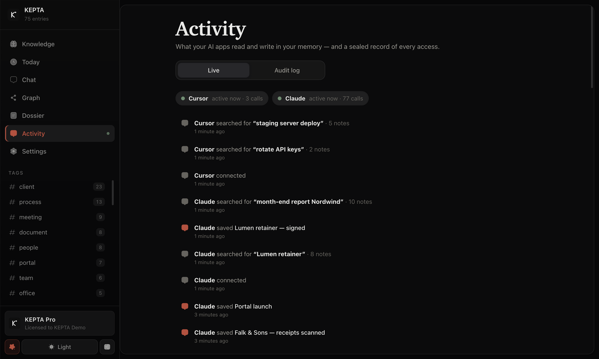
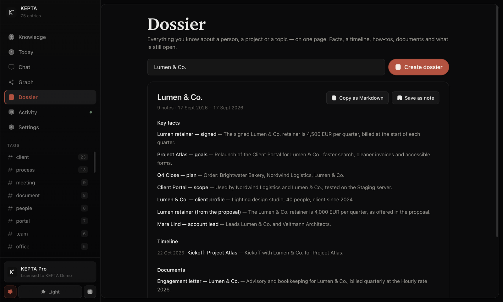
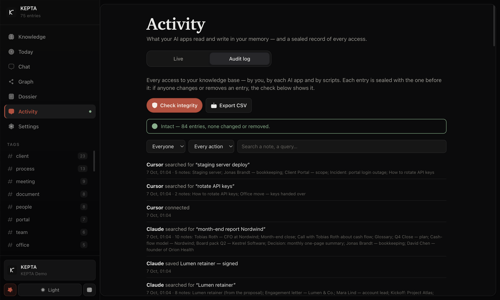
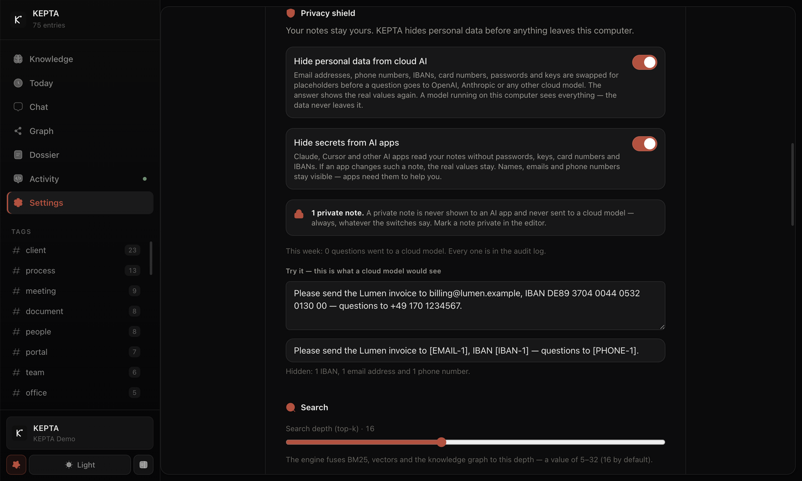
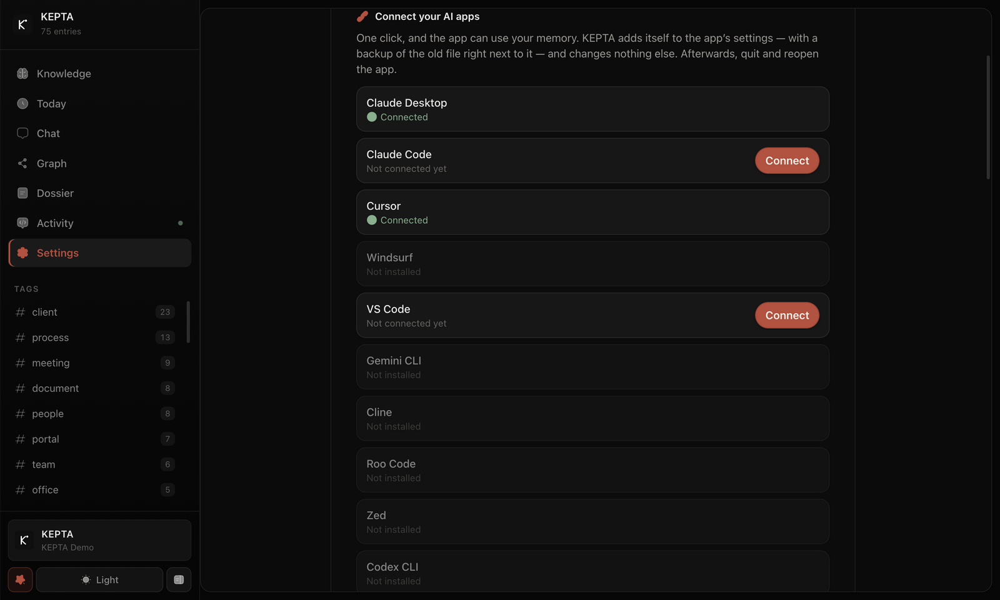
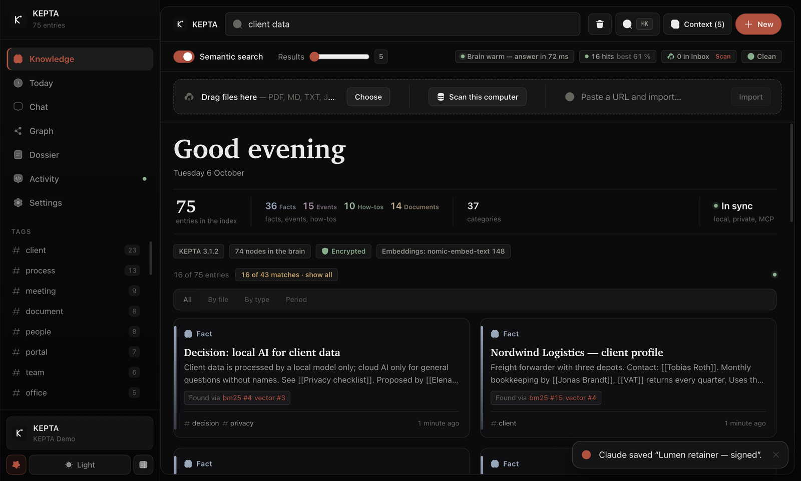
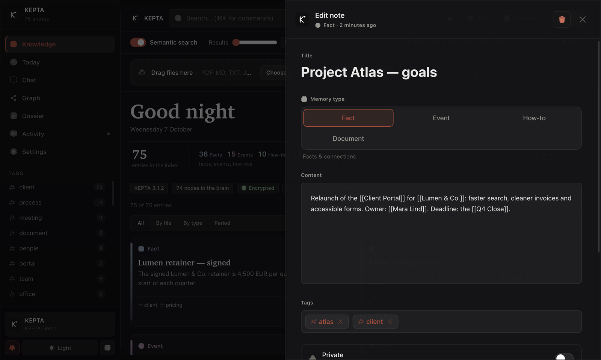
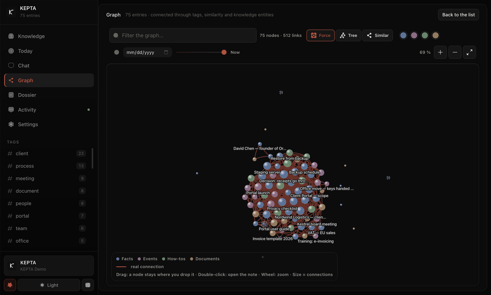
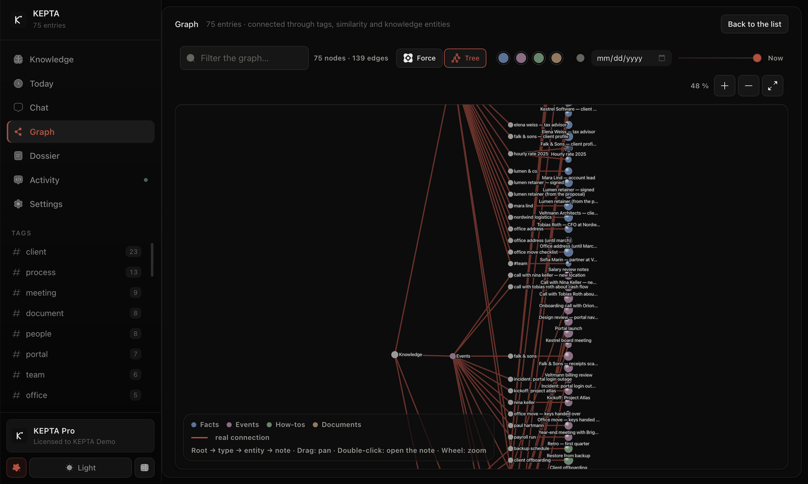
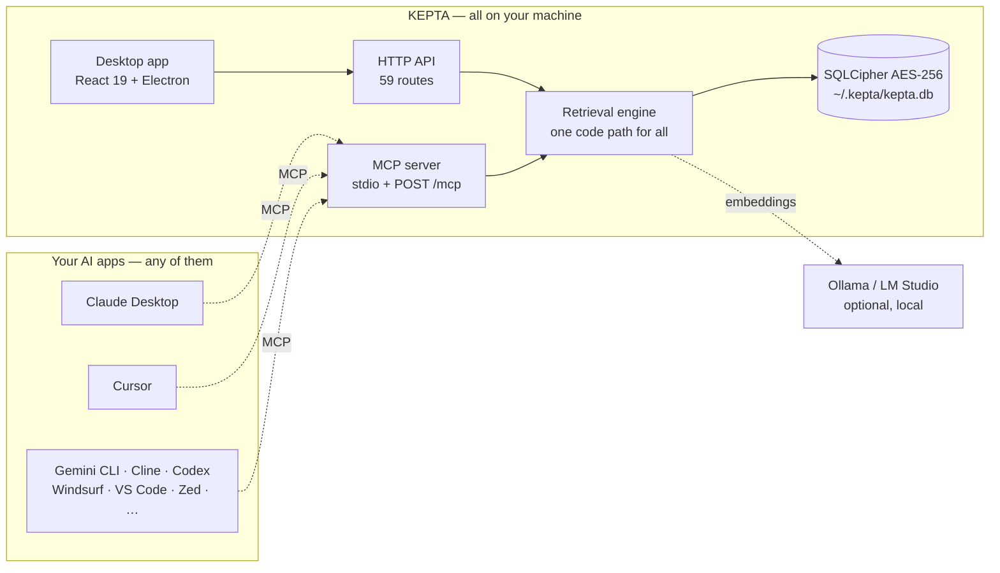

<p align="center"></p>
<h1 align="center">KEPTA — Keeps what matters</h1>
<p align="center"><strong>Your AI forgets you after every chat.<br>KEPTA remembers — on your own computer, in one encrypted file.</strong></p>

<p align="center"><sub>Desktop app · no cloud · no account · encrypted at rest<br>SQLite · hybrid retrieval · knowledge graph · MCP</sub></p>

<p align="center"><a href="https://github.com/DamianTodorovic/kepta/releases/latest"></a> <a href="https://github.com/DamianTodorovic/kepta/actions/workflows/ci.yml"></a> <a href="LICENSE"></a>   </p>

<p align="center"><sub>The memory engine underneath is source-available (BUSL-1.1, converts to AGPL-3.0-or-later after four years): <a href="https://github.com/DamianTodorovic/kepta">DamianTodorovic/kepta</a> — the headless core with the MCP server. This repository is the full desktop application.</sub></p>

## 🎬 Watch your knowledge grow

<p align="center"></p>

<p align="center"><a href="docs/demo.mp4">▶ Watch the film (MP4)</a> — same scene, smooth playback, ready for a second screen.</p>

<sub>Every entry is a node, every connection an edge — real connections drawn solid, mere similarity dashed. The time slider replays eighteen months of a fictional advisory firm, and because every note carries a validity window, past moments show exactly what was true then. The two views are the same data: *Force* shows the landscape of topics, *Tree* shows the order in it. Recorded from version 2.13.2 with `npm run screenshots` on an invented demo corpus — no real data, no real people.</sub>

| Today — since your last visit, and what needs a look | Activity — AI apps at work, live |
|---|---|
|  |  |
| **Dossier — a client on one page** | **Audit log — sealed and checkable** |
|  |  |
| **Privacy shield — what a cloud AI would see** | **Connect your AI apps** |
|  |  |
| **Index, grouped by kind — with a private note** | **Search stays ranked** |
|  |  |
| **Editor — kind, `[[links]]`, private** | **Settings — encrypted at rest** |
|  |  |

| Force — the physics layout | Tree — the dendrogram |
|---|---|
|  |  |

<sub>The Force layout positions thousands of nodes without overlap (verified at 3 000 nodes and 9 500 edges at 60 fps); the Tree reads out the hierarchy: root → kind of knowledge → entity or tag group → note. The third view, *Semantic*, places the same notes by what their texts mean — no screenshot of it here yet.</sub>

### Knowledge that has a date

Every memory carries a validity window, so the graph can be replayed: pull the time slider back, and every note that was not true yet at that moment dims — not deleted, simply not true *yet*. The same question works in search (`asOf` in the HTTP API and MCP) and in the editor, where every note shows its *valid from / valid until*. Firms use this for rates, mandates, contacts and anything that legally changes.

## 🙋 New here? Start with this

**The problem.** You use ChatGPT, Claude or something similar. You explain your project, your client, the way you like things done. The next day you open a fresh chat and it knows none of it. So you explain it again. And again. Meanwhile the platform quietly keeps what you told it — in their cloud, tied to their service, on their terms.

**What KEPTA is.** A small program that runs on your own computer and remembers those things for you. Your assistants read it and write back to it through **MCP** — the open protocol that Claude Desktop, Cursor, Gemini CLI, Cline, Codex and many others speak. The knowledge lives in **one encrypted file** on your machine: since 2.11, AES-256 at rest, the key in your system keychain. Not a cloud. Not a service. A file — like a document you own.

**What that looks like on an ordinary day.** You tell your assistant to remember that your client bills quarterly. Two weeks later, in a brand-new chat with a *different* assistant, the answer is already right. You drop a PDF into a folder and your assistant can quote from it. A client changes address — and the old one stops coming back, because the new note *supersedes* the old instead of piling on top.

**Is it for you?**

- You use AI assistants daily and keep repeating yourself → yes.
- You handle client data, patient data or anything confidential → **yes, especially you**. This is the part the platforms cannot offer.
- You are looking for a notes app to read and write by hand → probably not. KEPTA is built so your *assistant* uses it — and you supervise.

### Do I need to be a developer?

**To use the app — no.** Download the file for your system, open it, done. It is an ordinary window: a list, a search box, a settings page. [Which file do I need?](#-which-file-do-i-need) tells you exactly which one to take.

**To connect it to your assistants — one click.** KEPTA finds the AI apps already installed on the computer and adds itself to their MCP settings. If your app is not on the list, the app shows you the exact block to paste — and anything that speaks HTTP has the REST API.

**For the smarter search — optional.** KEPTA searches perfectly well out of the box. Install [Ollama](https://ollama.com) — one free download — and it will additionally find notes that mean the same thing in different words.

<details>
<summary><strong>The words used on this page, in plain terms</strong></summary>

| Word | What it means here |
|---|---|
| **Agent** | An AI program that can use tools instead of only answering — Claude Desktop, Cursor or Gemini CLI, for instance. |
| **MCP** | The open protocol such programs use to talk to tools. KEPTA speaks it, so your assistants can read and write your notes. |
| **SQLite** | A database that is simply one file on your disk. Nothing to run, nothing to log into; you can copy it like a photo. |
| **Encryption at rest** | The file is stored encrypted (AES-256, SQLCipher format). Whoever holds only the file holds nothing readable. |
| **Keychain** | Where your operating system keeps secrets. KEPTA stores the database key there — no password to type, no key on the disk. |
| **Embedding / vector** | Text turned into numbers, so a computer can tell that "car workshop" and "garage" mean nearly the same thing. |
| **BM25 / full text** | Classic keyword search: it finds the words you actually typed. |
| **Knowledge graph** | Your notes linked to one another, like `[[links]]` in a wiki. |
| **RRF** | The formula that merges the three searches above into one ranking. |
| **Local-first** | Everything happens on your machine. No upload, no account, no telemetry. |

</details>

## 🎯 What it's for

1. **One brain for every AI tool.** Claude Desktop, Cursor, Gemini CLI, Cline, Codex — anything that speaks MCP shares the same encrypted knowledge base, plus anything that only speaks HTTP through the REST API. What one assistant learns, the next already knows.
2. **Keep agents sharp instead of letting them rot.** Every memory carries a type, a validity window and a confidence score. Contradictions supersede each other; expired facts are flagged, not silently served.
3. **A second brain found by meaning.** Ask *"what do I cook with pasta"* and the carbonara recipe comes back — once `ollama pull nomic-embed-text` has run. Without an embedding model, search stays lexical and still works.
   **Measured caveat, September 2026:** that example works in English and does not work in German. On a four-note check (`npm run embed:sprachtest`) the default model answers 4 of 4 English paraphrase questions and 1 of 4 of the same questions translated into German. The implementation is not at fault — normalised cosine, 768 dimensions — the default model is English-centric. If your notes are German, expect lexical search to carry most of the weight until you switch to a multilingual model such as `bge-m3`.
4. **Capture without friction.** Drag in files (PDF/MD/TXT), clip URLs, watch an inbox folder, save chat answers — or let KEPTA **read the documents already on your computer**: opt-in, with a preview of exactly what would be imported before a single file is opened. Keys, credentials, browser profiles, keychains and system folders are never read, and that cannot be switched off — because an imported note is readable by every agent you connect over MCP.
5. **Obsidian bridge.** Vault import and export (Markdown + frontmatter); `[[wiki links]]` become graph edges.
6. **Private, provably.** Everything lives in `~/.kepta/`, encrypted on disk, no account, no telemetry — and every AI access is written to a tamper-evident audit log you can check and export.
7. **Research-grade knowledge graph** that stays legible at thousands of nodes, duplicate review that shows you the pairs instead of just counting them, and a trash can with undo.
8. **Two-minute dev setup.** Copy the MCP config, `POST /mcp` (protocol 2026-07-28, 8 tools), HTTP API, `npm run eval` and `npm run ablation` (what each retrieval leg contributes).

## 🧩 Every feature

<details open>
<summary><strong>Capture &amp; store</strong></summary>

- Create, edit and delete notes — **trash instead of hard delete**, with restore
- **Memory types**: `semantic` (facts), `episodic` (events), `procedural` (how-to), `reference` (imported documents). Assigned by rule when the caller says nothing — with a stated reason like "3 numbered steps found". Rules, not a model: they run offline, they are readable, and they are tested. Existing notes can be sorted afterwards from Settings → Data, with a preview first
- **Scope**: `user`, `agent`, `session` — separates who a memory belongs to
- **Private notes** — one switch in the editor: a private note is never shown to an AI app and never sent to a cloud model — in the app *and* in the source-available core
- **Confidence** 0–1, free-form tags, automatically extracted entities
- **Temporal validity**: `valid_from` / `valid_to`. Expired entries are marked, never quietly hidden
- **Supersede chains** (`superseded_by`): contradictions displace each other and the history survives
- **Files** by drag and drop: PDF, MD, TXT, JSON — chunked at 2000 characters. PDF text comes from pdf.js with the character maps for embedded fonts (shipped with the app, served locally), so a form reads as letters rather than glyph names. Files imported with an older extraction can be read again under *Settings → Data → Re-read imported files* — it counts first and writes only after you confirm
- **URL clipper** with SSRF protection (IP literals in every notation, DNS resolution, every redirect hop checked); navigation lines, "Skip to main content" and cookie banners are stripped on import
- **Auto-learn** (**off** by default): on request, KEPTA saves the key point of each chat answer as a node (tag `auto-learn`). The first time an answer would have been learnable, it says so once — with a button to switch it on. Optional small extraction model, 45-second limit, and both success **and** failure are reported
- **Inbox folder** watched and ingested automatically
- **Obsidian vault import**: Markdown + YAML frontmatter, `[[wiki links]]` become graph edges
- **Import your AI history**: bring your ChatGPT or Claude data export here (*Settings → Data management → Import your AI history*): every conversation with at least one answer becomes a searchable note with its original date, tagged `chatgpt-import` / `claude-import` — so switching assistants doesn't mean starting over. Importing the same export again updates instead of duplicating
- **Markdown export** to `~/.kepta/export/`
- **Device Sync** — move a memory scope between your own devices as an **AES-256-GCM-encrypted bundle** (key derived from a passphrase, scrypt). Every transfer is recorded in a tamper-evident hash-chained ledger (`~/.kepta/sync-journal.jsonl`): the inspectable proof of what moved between devices, without the content ever being readable in transit
- **Migration** from the previous version (`memories.json`) — idempotent, with a backup

</details>

<details open>
<summary><strong>Search &amp; retrieval</strong></summary>

- **Hybrid retrieval**: FTS5 BM25 + vector KNN + entity match, fused with Reciprocal Rank Fusion
- **Local reranking**: a deterministic reranker (term coverage, phrase hits, title, tags) refines the fused ranking and is exposed as `rerankScore` — no network, always on
- **Time-travel search** (`asOf`): ask what was known at any moment — available in the HTTP API and MCP `memory_search`
- **Stopwords removed from the query** in both German and English, so a note does not gain rank merely by containing *with* or *die*
- **Persistent embeddings** via Ollama (`nomic-embed-text`), computed by a background queue instead of re-embedding on every query
- **Temporal weighting**: expired ×0.5, superseded ×0.4
- **Semantic search** can be switched off; the result slider runs 5 · 10 · 20 · 50 · 100 · 250 · **All**, and the index says how many notes match in total
- **Relevance first while you search** — a grouped list turns flat and ranked as soon as there is a query, so the best hit is on top
- **One code path** for the UI, the HTTP API and MCP — agents get exactly the quality you get
- **Eval harness**: `npm run eval` measures Hit@1 and Precision@5 against a fixed corpus

</details>

<details open>
<summary><strong>Knowledge graph</strong></summary>

- Entities and relations from `[[wiki links]]` and automatic extraction
- A concept in the picture is a shared one: a term that exists only because it repeats the title of the single note carrying it is an echo of your filing, not knowledge, and the graph leaves it out — the concept count is then the number of things your notes actually share
- **Three views** — *Force*, the physics layout; *Tree*, a dendrogram from the root to the kind of knowledge to an entity or tag group to the note; and *Semantic*, the notes placed by a deterministic projection of their own vectors. Nodes glide from one view to another, and with reduced motion they jump
- The Tree folds itself to fit its canvas: 400 notes are 425 rows and no screen holds that, so the deepest groups step behind a `×N` badge, the line says how many notes are gathered, and one click opens everything again
- The semantic map says what it leaves out: how much of the difference its two axes carry, how many vectors the cap held back, and where the notes without a vector were parked. It is computed on the server, so no embedding ever travels into the view
- Force-directed layout on an **unbounded canvas** — nodes repel each other, never overlap, and follow when you drag their neighbours; the layout grows with the base instead of being squeezed into the window. Verified at 3 000 nodes and 9 500 edges at 60 fps. Repulsion is weighted against the link springs, not against nothing: on a 400-note base the topics stand apart as islands with white space between them, instead of petals touching
- **Forces you can set** — how hard the middle gathers, how hard notes repel, how long a link rests, how big the nodes are. Turning a slider does not rebuild the world: the picture keeps its place and settles under the new forces, and one click returns the tuned defaults
- Zoom, pan, draggable nodes, and **fit-to-view** that always frames the whole graph — the whole graph includes the strip the legend takes at the bottom
- **Search counts its hits** — how many notes match, and which one you are on. Enter jumps and pages, Shift+Enter goes back, Escape clears the word before it touches anything else
- **Time slider** — shows what was known at a chosen point in time, now date-exact
- Colour by memory type — or by where a note came from: a file, this computer, written here. The second channel switches itself off with the reason when the base holds only one kind of arrival; it never paints everything grey. Node size by number of connections
- Tells a real connection apart from mere similarity
- **Schema panel** — what the store holds, counted: kinds of note, concepts, and every claim type by name. A row is a handle: everything the store does not claim through it steps back
- Double-click opens the note

</details>

<details open>
<summary><strong>Maintenance &amp; consolidation</strong></summary>

- **Duplicate detection** by embedding similarity (≥ 0.92), with a lexical fallback when Ollama is absent
- **Settings live in the encrypted data directory**, not in browser storage — the desktop shell binds to a free port that changes on every launch, and `localStorage` is keyed by origin, so anything kept there was gone after a restart
- **Consolidation supersedes instead of deleting** — nothing is lost
- **Episodic memories** grow out of chat history

</details>

<details open>
<summary><strong>Today, dossiers and contradictions</strong></summary>

- **Today** (⌘5) — what is new since your last visit and who added it (you, an import or which AI app), what changed, the open to-dos from your notes, what expires soon and what your AI apps did. Read straight from the local database: no AI involved, nothing leaves the computer
- **Contradictions** — two notes that name a different time, date, amount, percentage or quantity for the same thing appear side by side, the differing value in bold. *Keep the newer*, *Keep the older* (the other is marked as replaced, never deleted) or *Both are right* (never asked again). Careful on purpose: only facts and how-tos are compared, both sentences must share their meaningful words, notes from the same file stay out, and so do the parts of a split file ("README — 5/17"), a note's source line and ranges like "2–4 days"
- **Dossier** (⌘6) — everything about a person, a project or a topic on one page: key facts, a timeline, how-tos, documents, open to-dos, contradictions and related topics. *Copy as Markdown* or *Save as note*

</details>

<details open>
<summary><strong>Your AI apps — connected, visible, accountable</strong></summary>

- **Connect in one click** — KEPTA finds the AI apps already installed (Claude Desktop, Claude Code, Cursor, Windsurf, VS Code, Gemini CLI, Cline, Roo Code) and adds itself to their MCP settings, pointing to the server inside the app (no Node, no npm). Zed, Codex CLI, Continue and every other MCP client get the exact snippet to paste. A backup of the old file sits right next to it, every other entry stays, and a file that is not plain JSON is never touched
- **Live activity** (⌘7) — which app is active right now and what it searched, saved or changed, with a message the moment it happens: *Claude saved "…"*
- **Audit log** — every access to the knowledge base, by you, by each AI app and by scripts, with exactly the notes an app got to see. Every entry is sealed with the SHA-256 of the one before it; *Check integrity* shows whether anything was changed, removed or cut off. Export as CSV, safe against spreadsheet formulas. A note's preview says which app read it and when
- **Privacy shield** — before a question goes to a cloud model, email addresses, phone numbers, IBANs, card numbers, passwords and keys become placeholders like `[EMAIL-1]`; the answer shows the real values again, even while it streams. AI apps read notes without passwords, keys, card numbers and IBANs, and if one writes a note back, the real values stay. Private notes never reach an app or a cloud model. Card numbers must pass the Luhn check and IBANs the mod-97 check; dates are never taken for phone numbers. Both protections are on by default, and every cloud request is in the audit log
- **Managed deployment & central policies** — IT deploys one `managed-settings.json` (the macOS MDM path, since the app ships macOS only; the Windows and Linux paths are in the same reader for self-built packages — or set `KEPTA_MANAGED_CONFIG`): the license comes pre-provisioned and is validated offline as always, and central policies are enforced server-side, not just in the window — `chat_cloud: deny` allows local models only, `machine_scan: deny` stops the scan, `privacy_shield: force_on` keeps the shield on. No license server, no phone-home, no extra infrastructure — one file. *Settings → Organization* shows what is managed and which policies are active. Details for procurement: [SECURITY-ENTERPRISE.md](SECURITY-ENTERPRISE.md)

</details>

<details open>
<summary><strong>Agent interface (MCP)</strong></summary>

Protocol `2026-07-28`, backwards compatible with `2025-06-18` and `2024-11-05`. Two transports: **stdio** and **Streamable HTTP** (`POST /mcp`). All eight tools ship an `outputSchema` and return `structuredContent`.

**Write gate (opt-in).** With `KEPTA_WRITE_GATE=on`, `memory_save` consults the local LLM before storing a *new* memory: ADD, UPDATE (rewrites the closest existing node instead of creating a duplicate), DELETE or NOOP. Without a reachable local LLM it always degrades to ADD — the gate can never block you.

| Tool | Purpose |
|---|---|
| `memory_search` | Hybrid retrieval with temporal weighting |
| `memory_save` | Create, including type, scope and validity |
| `memory_update` | Change an existing memory |
| `memory_delete` | Move to trash |
| `memory_list` | Filter by type, scope, tags |
| `memory_graph` | Query entities and relations |
| `memory_consolidate` | Find and merge duplicates |
| `memory_forget` | Expire or supersede |

</details>

<details>
<summary><strong>Chat cockpit</strong> — a proving ground, not a feature magnet</summary>

- **20 provider presets**: Ollama, LM Studio, OpenAI, Anthropic, Gemini, Mistral, Groq, DeepSeek, xAI, Perplexity, Together, Fireworks, Cohere, Cerebras, HuggingFace, Novita, OpenRouter, GitHub Models, Azure, custom endpoint
- **Model discovery** for Ollama and LM Studio in one click, no key required
- **SSE streaming** with a stop button, Markdown rendering
- **Source citations**: every answer shows which memories it used
- **Date-aware prompting** — today's date and validity markers go into the context
- **Token budget** visible

The chat exists to prove retrieval works. Day-to-day use runs through MCP.

</details>

<details>
<summary><strong>Interface</strong></summary>

- **Command palette** (⌘K) for everything without the mouse
- **Tag filter** with counts and multi-select
- **Light/dark** and **focus mode**
- **Setup wizard** with a themed starter pack
- **System status**: detects local AI, checks storage, shows diagnostics
- **Activity** (⌘7) with the live feed of your AI apps and the audit log; **Today** (⌘5) and **Dossier** (⌘6)
- **Duplicate review** — every group side by side, one click to keep the richest copy or dismiss the pair for good. Cleaning up is a single request for the whole batch with one undo, not one request per note (which used to run into the write limiter and stop halfway without saying so)
- **Scan this computer** — opt-in, with a preview before anything is read. You choose the folders, untick file types and name folders to leave out; the dialog shows the rules that actually apply, read from the same source that enforces them. Settings can only narrow what is read, never widen it: keys, credentials, browser profiles, keychains and wallets stay blocked, the size cap stays capped, and roots outside your home folder are refused. HTML is turned into text before import, and content that carries no knowledge — markup scaffolding, repeated table rows — never becomes a note
- **Knowledge list** — a click opens a readable preview: the full text, the source as a chip, *Copy text*; the editor opens from there. Every card shows where it came from and which part it is (2/5), and a file source opens in its default application. The list groups by file, by kind or by period, and *Load more* never cuts a group in half
- **Text size** — 100, 115 or 130 %, under *Settings → Display*. The interface is English; German notes and German queries work as well as English ones

</details>

<details>
<summary><strong>HTTP API — 59 routes</strong></summary>

| Area | Routes |
|---|---|
| Memories | `/api/memories`, `/api/memories/:id`, `/api/memories/:id/restore`, `/api/memories/bulk-delete`, `/api/memories/bulk-restore`, `/api/memories/reclassify`, `/api/memories/search`, `/api/memories/import`, `/api/memory` |
| Search &amp; graph | `/api/search`, `/api/graph`, `/api/graph/semantik` |
| Import &amp; export | `/api/import/markdown`, `/api/import/chat`, `/api/export/markdown`, `/api/clip`, `/api/repair/imports` |
| Inbox | `/api/inbox/status`, `/api/inbox/scan` |
| Chat | `/api/chat`, `/api/chat/stream`, `/api/models`, `/api/embed` |
| Today &amp; dossier | `/api/briefing`, `/api/contradictions/resolve`, `/api/dossier`, `/api/dossier/suggestions` |
| AI apps, audit &amp; privacy | `/api/agents`, `/api/clients`, `/api/clients/:id/connect`, `/api/audit`, `/api/audit/verify`, `/api/audit/export.csv`, `/api/memories/:id/readers`, `/api/shield` |
| License &amp; team | `GET /api/license`, `POST /api/license`, `GET /api/team` |
| MCP | `POST /mcp`, `/api/mcp/tools`, `/api/mcp/search`, `/api/mcp/save`, `/api/tools` |
| Device Sync | `/api/sync/export`, `/api/sync/import`, `/api/sync/journal` |
| System | `/api/health`, `/api/storage-info`, `/api/activity`, `/api/profile`, `/api/settings`, `/api/open`, `/api/recovery-key` |
| Machine scan | `/api/scan/preview`, `/api/scan/start`, `/api/scan/status`, `/api/scan/cancel`, `/api/scan/config`, `/api/scan/policy` |

</details>

<details>
<summary><strong>Privacy &amp; hardening</strong></summary>

- All data in `~/.kepta/` — one SQLite file that belongs to you
- **Encrypted on disk** (since 2.11): SQLCipher 4 format, AES-256 with an HMAC over every page, a random 256-bit key kept in the macOS Keychain on the shipped app (the same code uses Windows DPAPI or the Linux Secret Service when you build it there) — no password to type. Your settings, the AI key included, live inside the encrypted file. What it covers and what it does not, and how to keep a copy of the key: [SECURITY.md](SECURITY.md#encryption-at-rest)
- The server binds to **`127.0.0.1` only** (deliberate override via `KEPTA_HOST`), and answers only this computer — a website using DNS rebinding gets nothing
- **SSRF protection** in the URL clipper: normalised IP checks, DNS resolution, every redirect hop verified
- **Content Security Policy** in the Electron session, `nodeIntegration` off, sandbox on
- Rate limiting, Helmet, input validation on every route
- No account, no telemetry, no phone-home — the license check runs offline against a signature, it does not call a server
- With no AI configured, not a single byte leaves the machine
- **Privacy shield, private notes and the audit log** — see *Your AI apps* above

</details>

## 🏗️ How it fits together



No service in between, no account, no telemetry. The server binds to `127.0.0.1` unless you set `KEPTA_HOST` yourself. Your memories are stored only in that encrypted SQLite file — there is no server of mine for them to reach. The one path where data does leave is the app's optional chat: if you enter a key for OpenAI, Anthropic or another provider, what you send that provider goes to them — and the **privacy shield** makes sure it goes out without the personal details. It is off until you add a key, and the memory store is never synced anywhere.

## 🔍 How search decides


One query, three searches: full text finds the words you typed, the vector search finds what they *mean*, the graph contributes notes connected to named entities. RRF merges the three rankings — it works on ranks, so one track cannot win simply by producing bigger numbers. A deterministic reranker (term coverage, phrase hits, title, tags) refines the result and is exposed as `rerankScore`. Without Ollama the vector track drops out and everything continues lexically. Search degrades; it does not break.

## 📦 The MCP server on its own — the source-available core

```bash
npx -y kepta-mcp
```

That is the entire installation: one file and one dependency — SQLite with encryption, which npm installs prebuilt. It gives an agent a memory **without the desktop app** — same `~/.kepta/kepta.db`, same keychain key, so you can start headless and add the window later, or run both side by side. Needs Node 22.13 or newer. Listed in the [official MCP registry](https://registry.modelcontextprotocol.io) as `io.github.DamianTodorovic/kepta`.

The npm package is maintained in the source-available core repository: [DamianTodorovic/kepta](https://github.com/DamianTodorovic/kepta) · [npm](https://www.npmjs.com/package/kepta-mcp)

## 🐍 Python client

```bash
pip install kepta
```

```python
from kepta import KeptaClient

kepta = KeptaClient()          # finds the running instance on its own

kepta.save("Carbonara", "Guanciale, pecorino, egg yolk. No cream.", tags=["cooking"])

for hit in kepta.search("carbonara without cream"):
    print(f"{hit.score:.2f}  {hit.memory.title}")
```

Standard library only, no dependencies. It discovers the running app through `~/.kepta/endpoint.json`, so the random port a packaged build picks is not your problem. Details: [python/README.md](python/README.md) · [PyPI](https://pypi.org/project/kepta/)

## 🔐 KEPTA is free — and a license key only by agreement

There are two things to buy or not buy: **KEPTA Core**, free, and **KEPTA Enterprise**, by agreement. A license key is issued per buyer by Damian, not through a shop; this repository is private.

- **Every download comes with one unlimited day.** A fresh install runs 24 hours with every tool, unlimited — no panel, no account, no key. Then the app stays **KEPTA Core**: the same features with generous **daily limits**, never a locked window. The limits are **tamper-evident**: counters and the trial day live in a sealed, authenticated state in the encrypted database plus a first-start anchor kept in two independent local proof places (the keychain and a hidden anchor file outside the data folder) — an app restart resets nothing, a rolled-back clock forfeits the day, and editing, forging or deleting the state (even together with the database) is detected by consensus and costs the trial day, never the data. All of it stays on the machine; nothing phones home. When a limit is reached, the app answers with the upgrade path, never with a lock.
- **A key removes the limits.** One license key — issued per buyer, carrying a license number and bound to the buyer's name, which KEPTA shows in the sidebar (the name alone, without a tier label since 3.1.1). It is validated **offline** against a signature; nothing leaves the machine to check it. A key that is passed on can be revoked: its number goes on the list inside the app, and from the next update on that key stops unlocking anything.
- **Enterprise stays personal.** Team memory ships as the enforcement layer (licensed team scopes, roles, per-tenant isolation in KEPTA Enterprise), central policies ship as the managed configuration documented in [SECURITY-ENTERPRISE.md](SECURITY-ENTERPRISE.md), and the enterprise build runs on your own hardware — air-gapped if you need it. Sold as roadmap, not built yet: SSO (SAML/OIDC), the workspaces UI and MDM enrolment. One tier, shaped per organization; the license is pre-provisioned and validated offline as always.
- **The data is never hostage.** The knowledge base file stays on disk, encrypted, and readable by the source-available engine — with or without a key.

**Getting a key** — the Upgrade panel in the app points to the live path, which today is a direct message to [me on LinkedIn](https://www.linkedin.com/in/damian-todorovic-244235434); there is no self-serve checkout. **Enterprise** — [write to me on LinkedIn](https://www.linkedin.com/in/damian-todorovic-244235434).

### Icon attribution

The icon series embeds glyphs from **Solar** (CC BY 4.0, by 480 Design) and
**Tabler Icons** (MIT). Full list: [THIRD-PARTY-NOTICES.md](THIRD-PARTY-NOTICES.md).

## 🧠 The source-available core

The engine underneath this app is source-available — **BUSL-1.1**, at [DamianTodorovic/kepta](https://github.com/DamianTodorovic/kepta) (each release converts to AGPL-3.0-or-later after four years): storage with encryption at rest, hybrid retrieval with the reranker, the MCP server with all eight tools, and the HTTP API for the memory endpoints. Same database format, same keychain key, one code path for the quality of search.

That is deliberate, not a giveaway: anyone who has to prove that nothing leaks should be able to *read* it rather than believe it. An auditable core is worth more than a promise. And if the vendor disappears one day, the customer keeps working with the core; with closed software that would be the end of the road. The app is the complete window on top — graph views, editor, clipper, machine scan, chat cockpit, Device Sync — for people who want the whole product rather than a protocol.

## ⚡ Getting started

**Just want to use it.** Download the file for your system from [Releases](https://github.com/DamianTodorovic/kepta-pro-releases/releases/latest) and open it. The table below says which one. First launch needs one extra click because the app is not code-signed — that is explained per system further down.

**Connect it to your assistants.** One click inside the app, or one block of text into one file. No path, nothing to build — `npx` fetches the server the first time it is needed:

```json
{ "mcpServers": { "kepta": { "command": "npx", "args": ["-y", "kepta-mcp"] } } }
```

That is the whole connection, and it works without the desktop app: `npx -y kepta-mcp` gives an agent a memory on its own, in the same encrypted `~/.kepta/kepta.db` the app uses. If you would rather not have npx check the registry on every start, install it once with `npm i -g kepta-mcp` and use `"command": "kepta"` instead. The version with your own checkout path is in the app under *Settings → MCP / API*, with a copy button. In the installed app that page offers a third way first: the MCP server that ships inside KEPTA, started by the app itself — no Node.js, no npm.

**Run it from source.** The repository is private — you need access as a licensee. Node 22.13 or newer:

```bash
git clone git@github.com:DamianTodorovic/kepta-enterprise.git && cd kepta-enterprise
npm install && npm test && npm run eval
npm run dev        # http://localhost:3000
npm run electron   # desktop shell (optional)
```

### 📦 Which file do I need?

The desktop app is published **only for macOS** — Apple silicon and Intel. No other platform has a downloadable app, and nothing here pretends otherwise.

| Your system | File |
|---|---|
| Mac with Apple Silicon (M1–M4) | `KEPTA-<version>-mac-arm64.dmg` |
| Mac with an Intel processor | `KEPTA-<version>-mac-x64.dmg` |
| Windows or Linux | No app file is published. The engine itself runs on all three (`kepta-mcp` on npm, or from source), so an MCP client on those systems talks to the same memory — only the window is missing. |

Every published file carries its platform and architecture in the name. On a Mac, if you are unsure: Apple menu → *About This Mac* — "Apple M…" means `arm64`, "Intel" means `x64`. The `.zip` files are the same programs without an installer. The packages are self-contained; you only need Node ≥ 22.13 to build them yourself.

### 🍎 First launch on macOS

KEPTA is built without an Apple developer certificate, so the releases are **not notarised**. macOS quarantines the download and says the developer cannot be verified. The app is fine; what is missing is a certificate that costs 99 EUR a year.

The fastest way through, and the one that works on every macOS version:

```bash
xattr -dr com.apple.quarantine /Applications/KEPTA.app
```

Without the terminal: **System Settings → Privacy & Security**, scroll down to the message about KEPTA, click **Open Anyway**, and confirm with your password. Once, then never again.

> Older guides say to right-click the app and choose *Open*. Apple removed that route in macOS 15 — on current systems it does nothing. Use one of the two above.

The app bundle itself **is** signed, ad-hoc. That is not notarisation and does not remove the warning, but it does decide which warning you get: macOS treats KEPTA as an ordinary unsigned app you can approve, rather than a damaged one it refuses outright.

### 🛠️ Other platforms: build it yourself

`npm install && npm run build:win` or `build:linux` produce packages under `release/`. They are built from this source and never published here, so they are untested against a real installer download; treat them as source builds, not as shipped products. An unsigned Windows package also carries the usual SmartScreen warning on first launch (**More info** → **Run anyway**).

## 🧪 Quality & tests

**1975 tests**, run with Vitest and v8 coverage. The coverage thresholds are a hard gate: a commit that falls below any of them fails the run — and so does a README that names the wrong number of tests, because `npm run test:cov` ends by comparing it with the run.

```bash
npm run lint       # typecheck (tsc) + ESLint — 0 errors required
npm test           # 1975 tests (vitest)
npm run test:cov   # tests + coverage gate + test count in the README
npm run eval       # retrieval quality (Hit@1)
```

| Layer | Gate — CI fails below | What it covers |
|---|---|---|
| everything together | **89 %** of lines | core, browser logic, scan rules, server and every component |
| `src/core` (engine, store, MCP, migration) | **97 %** of lines · **100 %** of functions | data model, search, consolidation, MCP protocol |
| `src/scan` (machine-scan rules) | **98 %** of lines · **100 %** of functions | what may be read, and what never is |
| `src/lib` (browser logic) | **92 %** of lines | provider presets, profile, settings, sources, SSE, fetch client |
| `src/components` (UI) | **84 %** of lines | every component, the graph canvas included |

The server code lives in `server/` — `server/app.ts` assembles the middleware chain and mounts the routers, `server/router/` holds one module per feature area, `server/helfer/` the shared helpers, and `server.ts` itself is only the entry point that ties it together. The routers and helpers count towards the overall coverage gate; the only exclusion is the bootstrap, which binds a port and never runs in a unit test. The gates sit a little below what is reached, so they can only move up. Tests live in `tests/`, mirroring the source layout. New features follow TDD (RED → GREEN → REFACTOR).

## 🧠 Why KEPTA?

Obsidian is excellent for humans — but Markdown is not a memory: no types, no validity, no MCP. Mem0 and Letta are SDKs without a GUI. The platform memory is tied to one vendor's cloud. **KEPTA is both and neither**: an agent-native memory layer with a desktop app, local, encrypted, with a provable trail of who read what. Eval on a 58-note, 45-query corpus across five query categories (`npm run eval`): Hit@1 **62 %** for the engine, **51 %** for the v1 substring search it replaced. `npm run ablation` breaks it down per leg — full fusion reaches **64 %** against 62 % for BM25 alone, and answers all 45 queries instead of 36. The corpus, the queries and the ablation are all in the repository, so you can disagree with the numbers by rerunning them.

The division of roles: the **chat cockpit** proves retrieval works — daily use runs through MCP. [ROADMAP](ROADMAP.md) · [CHANGELOG](CHANGELOG.md)

**KEPTA** — built for focus. Keeps what matters.
