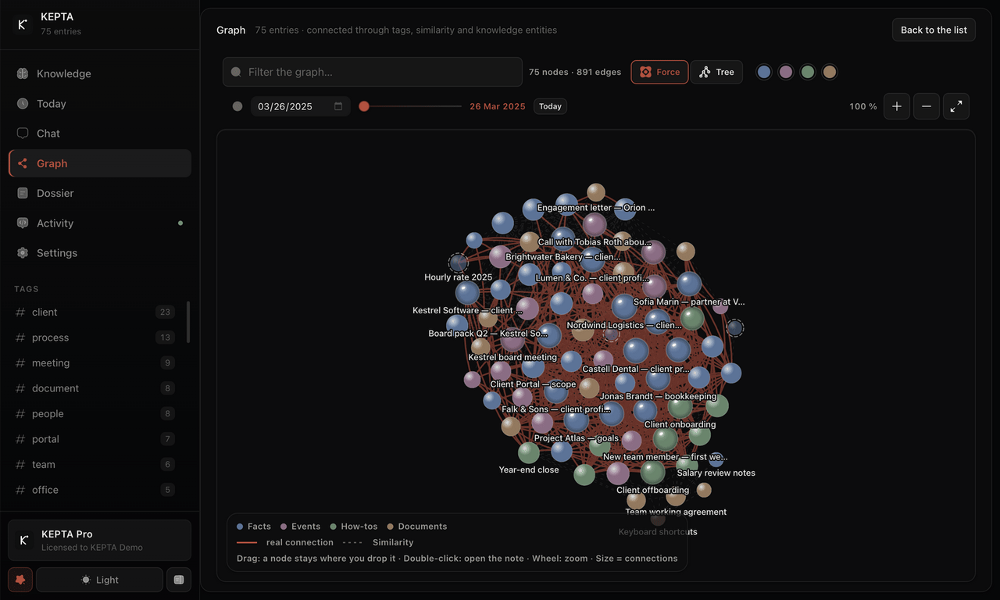
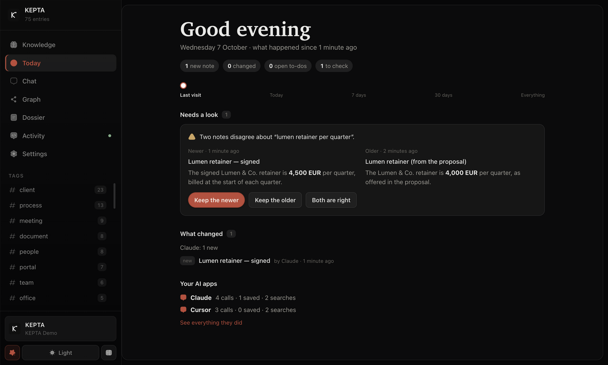
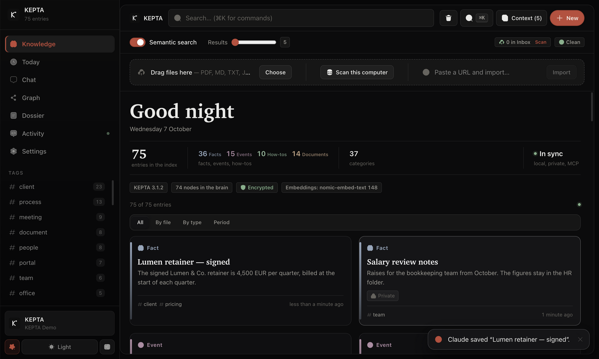
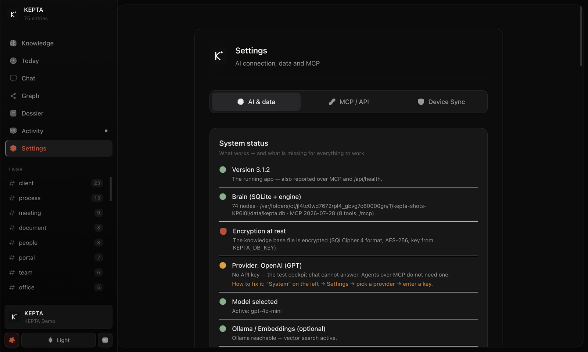
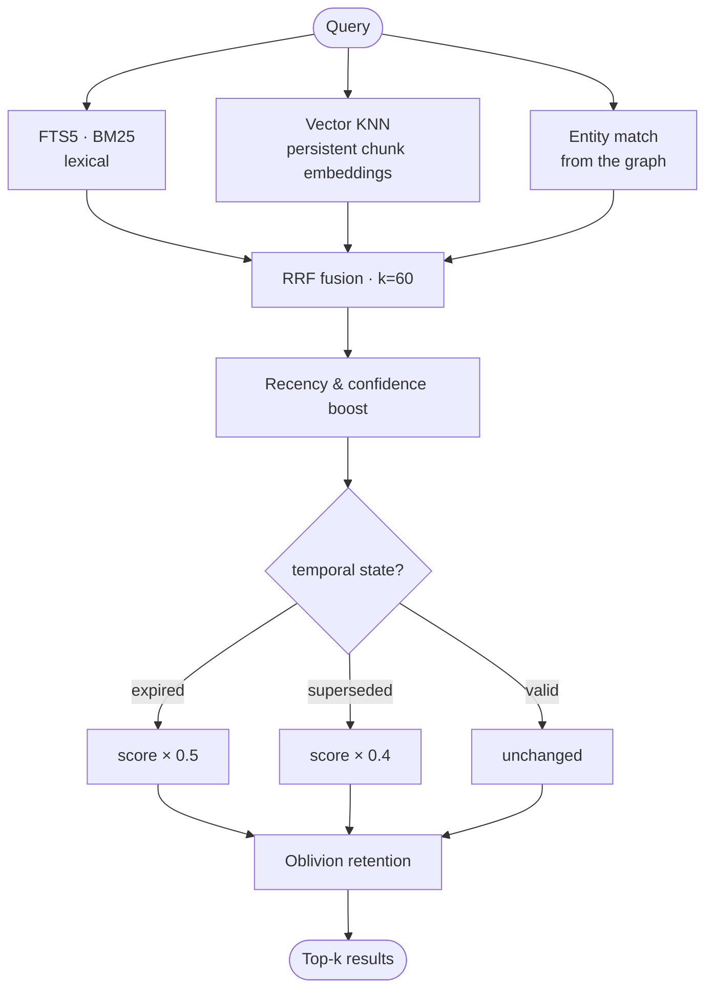

<p align="center"></p>
<h1 align="center">K3PTA — Keeps what matters</h1>
<p align="center"><strong>Your AI forgets you after every chat.<br>K3PTA remembers — on your own computer, in one encrypted file.</strong></p>

<p align="center"><sub>Desktop app · no cloud · no account · encrypted at rest<br>SQLite · hybrid retrieval · knowledge graph · MCP</sub></p>

<p align="center"><a href="https://github.com/DamianTodorovic/kepta/releases/latest"></a> <a href="https://github.com/DamianTodorovic/kepta/actions/workflows/ci.yml"></a> <a href="LICENSE"></a>   </p>

<p align="center"><sub>The memory engine underneath is source-available (BUSL-1.1, converts to AGPL-3.0-or-later after four years): <a href="https://github.com/DamianTodorovic/kepta">DamianTodorovic/kepta</a> — the headless core with the MCP server. This repository is the full desktop application.</sub></p>

## 🎬 Watch your knowledge grow

<p align="center"></p>

<p align="center"><a href="docs/demo.mp4">▶ Watch the film (MP4)</a> — same scene, smooth playback, ready for a second screen.</p>

<sub>Every entry is a node, every connection an edge — real connections drawn solid, mere similarity dashed (`tests/components/KnowledgeGraph.kanten-strich.test.tsx:121` counts the strokes in a frame without a similarity call, `:132` counts them with one, and both read the painted frame, not the rule). The time slider replays eighteen months of a fictional advisory firm, and because every note carries a validity window, past moments show exactly what was true then. The two views are the same data: *Force* shows the landscape of topics, *Tree* shows the order in it. Both films were recorded on 18 September 2026 with `npm run screenshots` on an invented demo corpus — no real data, no real people. **Their build number cannot be recovered from this repository:** its history starts on 1 October (`281f5a1`), two weeks after the recording, so the film shows an older surface than the one described here. The recorded stand of every picture lives in [`docs/bilder-manifest.json`](docs/bilder-manifest.json), and `node scripts/pruefe-bild.mjs` fails the README when a picture is older than the surface it illustrates.</sub>

<sub>**The twelve pictures below are from 7 October, version 3.1.2, stand `3b7f33f`** — before the design-system wave that is landing now, and before the tier and licence wording in this file. They show the product's structure, not its current face. A re-shoot on the final surface is queued.</sub>

| Today — since your last visit, and what needs a look | Activity — AI apps at work, live |
|---|---|
|  |  |
| **Dossier — a client on one page** | **Audit log — sealed and checkable** |
|  |  |
| **Privacy shield — what a cloud AI would see** | **Connect your AI apps** |
|  |  |
| **Index, grouped by kind — with a private note** | **Search stays ranked** |
|  |  |
| **Editor — kind, `[[links]]`, private** | **Settings — the system status board** |
|  |  |

| Force — the physics layout | Tree — the dendrogram |
|---|---|
|  |  |

<sub>The Force layout separates a dense base completely once it settles: **0 intersecting disc pairs at rest at 400, at 1 500 and at 3 000 notes**, asserted in `tests/lib/graphLayout.test.ts:2285` — re-check with `npx vitest run tests/lib/graphLayout.test.ts`. That test is a field without a browser; the delivered view has its own number, measured 4 November at 20:49-20:59 MEZ on the installed 3.2.148 with `node scripts/fps-laeufer.mjs` (`docs/belege/tag-0411/fps-3000-148-2049.log.txt`, `docs/belege/tag-0411/fps-3000-148-2052.log.txt`, `docs/belege/tag-0411/fps-3000-148-2054.log.txt`, `docs/belege/tag-0411/fps-400-148-2057.log.txt`, `docs/belege/tag-0411/fps-1500-148-2059.log.txt`): **0 pairs at 400 (418 discs), 0 at 1 500 (528 discs) and 0 at 3 000 in three separate runs (621, 646 and 625 discs, deepest cut 0 world units each)**; an hour earlier the same instrument had reported, measuring the then-delivered 3.2.145, **1 pair at 3 000 (707 discs, deepest cut 11 world units)** in `docs/belege/tag-0411/fps-3000-1610.log.txt`, and the difference between those two sentences is the rest-collision pass, which now keeps working for up to three seconds after the field comes to rest. The machine state printed in the same artefacts says why no millisecond there is claimed as a verdict. While it cools at 3 000 notes a few pairs still touch for a moment; `tests/lib/graphLayout.test.ts:2455-2458` pins that funnel at ≤ 40 pairs by step 250, ≤ 40 again by step 310 and zero by step 380, so no sentence here says „never overlaps" without naming the moment. What a frame costs at each size is timed in [`docs/graph-kosten.md`](docs/graph-kosten.md), not claimed in this caption — a millisecond number is only worth the quiet machine that produced it. The Tree reads out the hierarchy: root → kind of knowledge → entity or tag group → note. The third view, *Semantic*, places the same notes by what their texts mean — no screenshot of it here yet.</sub>

### Knowledge that has a date

Every memory carries a validity window, so the graph can be replayed: pull the time slider back, and every note that was not true yet at that moment dims — not deleted, simply not true *yet*. The same question works in search (`asOf` in the HTTP API and MCP) and in the editor, where every note shows its *valid from / valid until*. Firms use this for rates, mandates, contacts and anything that legally changes.

## 🙋 New here? Start with this

**The problem.** You use ChatGPT, Claude or something similar. You explain your project, your client, the way you like things done. The next day you open a fresh chat and it knows none of it. So you explain it again. And again. Meanwhile the platform quietly keeps what you told it — in their cloud, tied to their service, on their terms.

**What K3PTA is.** A small program that runs on your own computer and remembers those things for you. Your assistants read it and write back to it through **MCP** — the open protocol that Claude Desktop, Cursor, Gemini CLI, Cline, Codex and many others speak. The knowledge lives in **one encrypted file** on your machine: since 2.11, AES-256 at rest, the key in your system keychain. Not a cloud. Not a service. A file — like a document you own.

**What that looks like on an ordinary day.** You tell your assistant to remember that your client bills quarterly. Two weeks later, in a brand-new chat with a *different* assistant, the answer is already right. You drop a PDF into a folder and your assistant can quote from it. A client changes address — and the old one stops coming back, because the new note *supersedes* the old instead of piling on top.

**Is it for you?**

- You use AI assistants daily and keep repeating yourself → yes.
- You handle client data, patient data or anything confidential → **yes, especially you**. This is the part the platforms cannot offer.
- You are looking for a notes app to read and write by hand → probably not. K3PTA is built so your *assistant* uses it — and you supervise.

### Do I need to be a developer?

**To use the app — no.** Download the file for your system, open it, done. It is an ordinary window: a list, a search box, a settings page. [Which file do I need?](#-which-file-do-i-need) tells you exactly which one to take.

**To connect it to your assistants — one click.** K3PTA finds the AI apps already installed on the computer and adds itself to their MCP settings. If your app is not on the list, the app shows you the exact block to paste — and anything that speaks HTTP has the REST API.

**For the smarter search — optional.** K3PTA searches perfectly well out of the box. Install [Ollama](https://ollama.com) — one free download — and it will additionally find notes that mean the same thing in different words.

<details>
<summary><strong>The words used on this page, in plain terms</strong></summary>

| Word | What it means here |
|---|---|
| **Agent** | An AI program that can use tools instead of only answering — Claude Desktop, Cursor or Gemini CLI, for instance. |
| **MCP** | The open protocol such programs use to talk to tools. KEPTA speaks it, so your assistants can read and write your notes. |
| **SQLite** | A database that is simply one file on your disk. Nothing to run, nothing to log into; you can copy it like a photo. |
| **Encryption at rest** | The file is stored encrypted (AES-256, SQLCipher format). Whoever holds only the file holds nothing readable (`tests/core/store-verschluesselung.test.ts:102` tries a wrong key, names two ways forward and changes nothing on disk; `:149` refuses to start an empty brain over an encrypted file). |
| **Keychain** | Where your operating system keeps secrets. K3PTA stores the database key there, so there is no password to type. On macOS the key never sits in a file; on Windows it is the DPAPI-sealed `database-key.dpapi` in the data folder, readable only under the same account, and a headless install with `KEPTA_DB_KEY` keeps it in the process environment — the differences are spelled out in [SECURITY.md](SECURITY.md), and `tests/core/schluessel.test.ts:152` pins which bundle each system is handed. |
| **Embedding / vector** | Text turned into numbers, so a computer can tell that "car workshop" and "garage" mean nearly the same thing. |
| **BM25 / full text** | Classic keyword search: it finds the words you actually typed. |
| **Knowledge graph** | Your notes linked to one another, like `[[links]]` in a wiki. |
| **RRF** | The formula that merges the three searches above into one ranking. |
| **Local-first** | Everything happens on your machine. No upload, no account, no telemetry. |

</details>

## 🎯 What it's for

1. **One brain for every AI tool.** Claude Desktop, Cursor, Gemini CLI, Cline, Codex — anything that speaks MCP shares the same encrypted knowledge base, plus anything that only speaks HTTP through the REST API: one and the same store behind both doors, held by `tests/mcp-rest-paritaet.test.ts:66` (an agent writes with `memory_save`, then the HTTP list and the HTTP search return that note) and `:80` (the window writes with `POST /api/memories`, then `memory_search` finds it) — and kept honest by `:93` (a second, separate store must *not* show the note) and `:116` (two stores opened on one path *must*). What one assistant learns, the next already knows (`tests/mcp-rest-paritaet.test.ts:66` and `:80`, both directions, one store). The encrypted-at-rest half of that sentence is a different claim with its own cases: `tests/nebendateien.test.ts:22` puts nothing in plaintext on the plate and `:41` reads nothing back under a wrong key.
2. **Keep agents sharp instead of letting them rot.** Every memory carries a type and a confidence score — the type is the rules' answer when nobody set one, never a silent fall-back to *fact*, and an unset confidence reads as 1 (`tests/core/notiz-drei-felder.test.ts:53`, `:67`). The validity window is the one field a note really can lack: the row then holds null, and the reader decides — no start means the note's own creation date, no end means it never expires (`:75` reads both nulls back, `:87` and `:121` walk the time travel across that inferred start, `:102` holds an open end against a flagged one). Contradictions supersede each other and expired facts are marked, not silently served (`tests/components/MemoryCard.test.tsx:47` and `:52` read both marks off the rendered card, `tests/engine.test.ts:268` off the search hit)
3. **A second brain found by meaning.** Ask *"what do I cook with pasta"* and the carbonara recipe comes back — once `ollama pull nomic-embed-text` has run. Without an embedding model, search stays lexical and still works.
   **Measured caveat, September 2026, re-measured across the language border on 2026-11-03:** that example works in English and does not work in German. On a four-note check (`npm run embed:sprachtest`) the default model answers 4 of 4 English paraphrase questions and 1 of 4 of the same questions translated into German. The implementation is not at fault — normalised cosine, 768 dimensions — the default model is English-centric. And switching the model does not fix it: `bge-m3`, the multilingual model this file used to recommend, answered 3 of 15 English questions over the German test corpus where the default model answers 4 of 15 (`docs/belege/tag-0311/sprachuebergriff-bge-m3-1406.log.txt`, `docs/belege/tag-0311/sprachuebergriff-nomic-1406.log.txt`), and it embeds German notes worse in the same run — 46.7 % against 73.3 % Hit@1 on the vector leg alone. The honest position is therefore: search in the language your notes are written in, and treat a question in another language as a lexical problem. That gap is measured, named, and open. Changing the default would also mean re-embedding every stored note, because each chunk is keyed to the model that produced it (`npm run eval:sprache` reruns both sides).
4. **Capture without friction.** Drag in files (PDF/MD/TXT), clip URLs, watch an inbox folder, save chat answers — or let K3PTA **read the documents already on your computer**: opt-in, with a preview of exactly what would be imported before a single file is opened. Keys, credentials, browser profiles, keychains and system folders are never read, and that cannot be switched off (`tests/scan/regeln.test.ts` tries to open the barrier with a widened file-type list and is refused) — because an imported note is readable by every agent you connect over MCP.
5. **Obsidian bridge.** Vault import and export (Markdown + frontmatter); `[[wiki links]]` become graph edges.
6. **Private, provably.** Everything lives in `~/.kepta/`, encrypted on disk, no account, no telemetry. Every change to the knowledge base — and every call through the MCP door, its searches included — is written to a tamper-evident audit log you can check and export (`tests/kette-deckt-nur-schreibwege.test.ts:55` writes through HTTP and finds the entry, `:72` searches through the MCP door and finds the chain written). A plain HTTP read leaves no chain entry (`:62`): the log records what was done to your memory, not every glance.
7. **Research-grade knowledge graph** that stays legible at thousands of nodes, duplicate review that shows you the pairs instead of just counting them, and a trash can with undo.
8. **Two-minute dev setup.** Copy the MCP config, `POST /mcp` (protocol 2026-07-28, 8 tools), HTTP API, `npm run eval` and `npm run ablation` (what each retrieval leg contributes).

## 🧩 Every feature

<details open>
<summary><strong>Capture &amp; store</strong></summary>

- Create, edit and delete notes — **trash instead of hard delete**, with restore
- **Memory types**: `semantic` (facts), `episodic` (events), `procedural` (how-to), `reference` (imported documents). Assigned by rule when the caller says nothing — with a stated reason like "3 numbered steps found". Rules, not a model: they run offline, they are readable, and they are tested. Existing notes can be sorted afterwards from Settings → Data, with a preview first
- **Scope**: `user`, `agent`, `session` — separates who a memory belongs to
- **Private notes** — one switch in the editor: a private note is never shown to an AI app and never sent to a cloud model — in the app (`tests/mcp.test.ts` refuses it over MCP even when an agent asks by scope; `tests/enterprise-api.test.ts` reads the outbound cloud prompt and finds the note gone, counted as `privateNotes: 1`) *and* in the source-available core, whose own MCP suite carries the same floor (`tests/mcp.test.ts` in [DamianTodorovic/kepta](https://github.com/DamianTodorovic/kepta): private notes, their graph edges, their duplicates and their pointers stay invisible to agents)
- **Confidence** 0–1, free-form tags, automatically extracted entities
- **Temporal validity**: `valid_from` / `valid_to`. Expired entries are marked, never quietly hidden (`tests/engine.test.ts:78-83` asks for an expired note, gets it back with `expired: true`, and sees it ranked below the fresh one rather than missing)
- **Supersede chains** (`superseded_by`): contradictions displace each other and the history survives
- **Files** by drag and drop: PDF, MD, TXT, JSON — chunked at 2000 characters. PDF text comes from pdf.js with the character maps for embedded fonts (shipped with the app, served locally), so a form reads as letters rather than glyph names. Files imported with an older extraction can be read again under *Settings → Data → Re-read imported files* — it counts first and writes only after you confirm
- **URL clipper** with SSRF protection: 16 literal notations refused before a byte is fetched — `tests/server.test.ts:1022` holds the five IPv4 forms (decimal, hex, octal, IPv4-mapped IPv6, dotted with a port) and `tests/server.test.ts:1031` holds eleven more carried inside IPv6 addresses, including `64:ff9b::7f00:1` and `2002:7f00:1::`, which embed 127.0.0.1 in a form the gate let through until today, while the same case insists a genuinely public IPv6 target is still fetched; every DNS answer is checked too (`tests/server.test.ts:1088`), and so is every redirect hop, up to five, after which the clip answers 508 instead of showing a page (`tests/server.test.ts:1111` and `tests/server.test.ts:1134`); navigation lines, `Skip to main content` and cookie banners are stripped on import
- **Auto-learn** (**off** by default): on request, K3PTA saves the key point of each chat answer as a node (tag `auto-learn`). The first time an answer would have been learnable, it says so once — with a button to switch it on. Optional small extraction model, 45-second limit (`src/lib/autolearn.ts:11`), and both success **and** failure are reported
- **Inbox folder** watched and ingested automatically
- **Obsidian vault import**: Markdown + YAML frontmatter, `[[wiki links]]` become graph edges
- **Import your AI history**: bring your ChatGPT or Claude data export here (*Settings → Data management → Import your AI history*): every conversation with at least one answer becomes a searchable note with its original date, tagged `chatgpt-import` / `claude-import` — so switching assistants doesn't mean starting over. Importing the same export again updates instead of duplicating
- **Markdown export** to `~/.kepta/export/`
- **Device Sync** — move a memory scope between your own devices as an **AES-256-GCM-encrypted bundle** (key derived from a passphrase, scrypt). Every transfer is recorded in a tamper-evident hash-chained ledger (`~/.kepta/sync-journal.jsonl`): the inspectable proof of what moved between devices, without the content ever being readable in transit (`tests/praxissync.test.ts:101` finds no plaintext in a bundle and refuses a wrong passphrase and a tampered package; `:120` checks that every line chains its predecessor, so an edit stays visible)
- **Migration** from the previous version (`memories.json`) — idempotent, with a backup

</details>

<details open>
<summary><strong>Search &amp; retrieval</strong></summary>

- **Hybrid retrieval**: FTS5 BM25 + vector KNN + entity match, fused with Reciprocal Rank Fusion
- **Local reranking**: a deterministic reranker (term coverage, phrase hits, title, tags) refines the fused ranking and is exposed as `rerankScore` — no network, always on (`tests/core/lokaler-rerank.test.ts` scores with the embedding service stubbed dead, counts zero requests while doing it, and demands the identical number when the clock and the dice are wound forward)
- **Time-travel search** (`asOf`): ask what was known at any moment — available in the HTTP API and MCP `memory_search`
- **Stopwords removed from the query** in both German and English, so a note does not gain rank merely by containing *with* or *die*
- **Persistent embeddings** via Ollama (`nomic-embed-text`), computed by a background queue instead of re-embedding on every query
- **Temporal weighting**: expired ×0.5, superseded ×0.4
- **Meaning search** can be switched off, and the result slider runs 5 · 10 · 20 · 50 · 100 · 250 · **All** — `tests/components/Dashboard.test.tsx:206` drives all seven positions of the rendered control and reads each label back, `tests/lib/treffer-stufen.test.ts:47` counts the stops in the list that control is built from, and `:76` fixes where a number outside them lands: the smallest step, never "All", because a limit nobody chose must not quietly turn into "show everything". Switching the leg off leaves the keyword filter working (`tests/components/Dashboard.test.tsx:194`), and where the door sent more hits than the step shows, the strip names both numbers (`tests/components/Dashboard.test.tsx:234` reads "3 of 7 hits" off the search)
- **Relevance first while you search** — a grouped list turns flat and ranked as soon as there is a query, so the best hit is on top
- **One code path** for the UI, the HTTP API and MCP — agents get exactly the quality you get
- **Eval harness**: `npm run eval` measures Hit@1 and **Recall@5 (capped)** against a fixed corpus — capped because the denominator is `min(5, relevant notes)`, not 5, so the figure says how much of the answer set arrived rather than how clean the five are. `npm run ablation` divides by 5 and reports a real P@5 on the same corpus: two metrics, two names, never comparable (`tests/eval-metrik.test.ts:37` pins the capped divisor, `:55` pins the division by five and the P@5 name, `:48` fails any tool that says precision while computing recall). Both are cited line by line under "Why K3PTA?", where the runs themselves are kept in the repository.

</details>

<details open>
<summary><strong>Knowledge graph</strong></summary>

- Entities and relations from `[[wiki links]]` and automatic extraction
- A concept in the picture is a shared one: a term that exists only because it repeats the title of the single note carrying it is an echo of your filing, not knowledge, and the graph leaves it out — the concept count is then the number of things your notes actually share
- **Three views** — *Force*, the physics layout; *Tree*, a dendrogram from the root to the kind of knowledge to an entity or tag group to the note; and *Semantic*, the notes placed by a deterministic projection of their own vectors. Nodes glide from one view to another, and with reduced motion they jump
- The Tree folds itself to fit its canvas: a base of a few hundred notes needs more rows than any screen holds, so the deepest groups step behind a `×N` badge, the line says how many notes are gathered, and one click opens everything again. How many rows a given tree shows is a property of that tree's shape — leaves, groups, types, root — not of its note count, and the figure this sentence used to name for "400 notes" had no run behind it in the repository, so it is gone rather than kept; what is asserted here is asserted by `tests/lib/graphHierarchy.test.ts`, which counts the visible rows of trees it builds itself and holds the fold to its frame
- The semantic map says what it leaves out: how much of the difference its two axes carry, how many vectors the cap held back, and where the notes without a vector were parked. It is computed on the server, so no embedding ever travels into the view (`tests/rest-semantik.test.ts:70` reads the raw HTTP body and refuses any word like embedding, vektor or vector in it)
- Force-directed layout on an **unbounded canvas** — nodes repel each other and follow when you drag their neighbours; the layout grows with the base instead of being squeezed into the window. What is asserted, not asserted-away: **at rest no two discs intersect at 400, at 1 500 and at 3 000 notes in that test's field** (`tests/lib/graphLayout.test.ts:2285`, brute force over every pair, no padding, no browser — `npx vitest run tests/lib/graphLayout.test.ts`), and while the layout cools at 3 000 notes the funnel closes from ≤ 40 pairs at step 250 to 0 at step 310. Frame cost per size is measured and recorded in [`docs/graph-kosten.md`](docs/graph-kosten.md) with its machine conditions; it is deliberately not quoted here. Repulsion is weighted against the link springs, not against nothing: on a 400-note base the topics stand apart as islands with white space between them, instead of petals touching
- **Forces you can set** — how hard the middle gathers, how hard notes repel, how long a link rests, how big the dots are. Turning a slider does not rebuild the world: the picture keeps its place and settles under the new forces, and one click returns the tuned defaults
- Zoom, pan, draggable nodes, and **fit-to-view** that frames the whole graph — the whole graph includes the strip the legend takes at the bottom. At phone width a readability floor can decide the size instead of the frame; when it does, the button says so in its own title, and `tests/components/graph-fit-390-keine-verlust.test.tsx:73` holds the one promise that survives both cases: a press never shows fewer of the 34 notes than the view before it (`:88` is the drift control that proves the count is read at one world, not two)
- **Search counts its hits** — how many notes match, and which one you are on. Enter jumps and pages, Shift+Enter goes back, Escape clears the word before it touches anything else
- **Time slider** — shows what was known at a chosen point in time, now date-exact
- Colour by memory type — or by where a note came from: a file, this computer, written here. The second channel switches itself off with the reason when the base holds only one kind of arrival; it never paints everything grey (`tests/components/KnowledgeGraph.render.test.tsx:3537` finds the Provenance control disabled with a title that names the single kind and says there is nothing to tell apart, and `:3546` hands the channel back for two kinds and reads both colours off the canvas). Dot size by number of connections
- Tells a real connection apart from mere similarity
- **Schema panel** — what the store holds, counted: kinds of note, concepts, and every claim type by name. A row is a handle: everything the store does not claim through it steps back
- Double-click opens the note

</details>

<details open>
<summary><strong>Maintenance &amp; consolidation</strong></summary>

- **Duplicate detection** by embedding similarity (≥ 0.92), with a lexical fallback when Ollama is absent
- **Settings live in the encrypted data directory**, not in browser storage — the desktop shell binds to a free port that changes on every launch, and `localStorage` is keyed by origin, so anything kept there was gone after a restart
- **Consolidation supersedes instead of deleting** — nothing is lost
- **Episodic memories** grow out of chat history

</details>

<details open>
<summary><strong>Today, dossiers and contradictions</strong></summary>

- **Today** (⌘5) — what is new since your last visit and who added it (you, an import or which AI app), what changed, the open to-dos from your notes, what expires soon and what your AI apps did. Read straight from the local database: no AI involved, nothing leaves the computer
- **Contradictions** — two notes that name a different time, date, amount, percentage or quantity for the same thing appear side by side, the differing value in bold. *Keep the newer*, *Keep the older* (the other is marked as replaced, never deleted — `tests/enterprise-api.test.ts:215` reads the replaced note back with `supersededBy` set, and `tests/engine.test.ts:167` counts both notes still active after a consolidation marks one) or *Both are right* (never asked again — `tests/enterprise-api.test.ts:227` settles a pair that way, reads the list back empty and shows that neither note was superseded). Careful on purpose: only facts and how-tos are compared, both sentences must share their meaningful words, notes from the same file stay out, and so do the parts of a split file (`README — 5/17`), a note's source line and ranges like `2–4 days`
- **Dossier** (⌘6) — everything about a person, a project or a topic on one page: key facts, a timeline, how-tos, documents, open to-dos, contradictions and related topics. *Copy as Markdown* or *Save as note*

</details>

<details open>
<summary><strong>Your AI apps — connected, visible, accountable</strong></summary>

- **Connect in one click** — K3PTA finds the AI apps already installed (Claude Desktop, Claude Code, Cursor, Windsurf, VS Code, Gemini CLI, Cline, Roo Code) and adds itself to their MCP settings, pointing to the server inside the app (no Node, no npm) — those eight names are the machine's own auto-connect list, not a copy of this sentence: `tests/lib/einrichtung.test.ts:140` compares id for id and name for name, and `:169` reads this line out of README.md and fails if the paper names an app the code does not know, or the code knows one the paper hides. Zed, Codex CLI, Continue and every other MCP client get the exact snippet to paste (`tests/lib/einrichtung.test.ts:117` checks each snippet and `:159` that none of those four is ever offered a click). A backup of the old file sits right next to it, every other entry stays, and a file that is not plain JSON is never touched (`tests/lib/einrichtung.test.ts:42` checks the backup and the untouched neighbours, `:61` hands a commented file to the connector and gets refusal, not a rewrite)
- **Live activity** (⌘7) — which app is active right now and what it searched, saved or changed, with a message the moment it happens: *Claude saved "…"*
- **Audit log** — every access to the knowledge base, by you, by each AI app and by scripts, with exactly the notes an app got to see. Every entry is sealed with the SHA-256 of the one before it; *Check integrity* shows whether anything was changed, removed or cut off. Export as CSV, safe against spreadsheet formulas. A note's preview says which app read it and when
- **Privacy shield** — before a question goes to a cloud model, email addresses, phone numbers, IBANs, card numbers, passwords and keys become placeholders like `[EMAIL-1]`; the answer shows the real values again, even while it streams. AI apps read notes without passwords, keys, card numbers and IBANs, and if one writes a note back, the real values stay. Private notes never reach an app or a cloud model — the same two checks apply here: `tests/mcp.test.ts` refuses a private note at the MCP door even when an agent asks for it by scope, and `tests/enterprise-api.test.ts` reads the outbound cloud prompt and finds the note gone. Card numbers must pass the Luhn check and IBANs the mod-97 check; dates are never taken for phone numbers (`tests/lib/schild.test.ts:39` runs both validators head-on — one shifted IBAN digit and an all-zero card number fail; `:34` offers a date, a time, a version, an order number and a card with a bad check digit and finds nothing). Both protections are on by default, and every cloud request is in the audit log
- **Managed deployment & central policies** — IT deploys one `managed-settings.json` (the macOS MDM path, since the app ships macOS only — the published names are counted in `docs/belege/aussendung-0611/github-releases-0611.json`; the Windows and Linux paths sit in the same reader and are driven one platform at a time in `tests/richtlinien.test.ts:197` — or set `KEPTA_MANAGED_CONFIG`): a licence field in that file is **ignored**, because the downloadable app has no key left to validate (`tests/richtlinien.test.ts:106` keeps the policies, `:122` treats a key-only file as no policy), and central policies are enforced server-side, not just in the window — `chat_cloud: deny` allows local models only, `machine_scan: deny` stops the scan, `privacy_shield: force_on` keeps the shield on. No license server, no phone-home, no extra infrastructure — one file. *Settings → Organization* shows what is managed and which policies are active. Details for procurement: [SECURITY-ENTERPRISE.md](SECURITY-ENTERPRISE.md)

</details>

<details open>
<summary><strong>Agent interface (MCP)</strong></summary>

Protocol `2026-07-28`, backwards compatible with `2025-06-18` and `2024-11-05`. Two transports: **stdio** and **Streamable HTTP** (`POST /mcp`). All eight tools ship an `outputSchema` and return `structuredContent`.

**Write gate (opt-in).** With `KEPTA_WRITE_GATE=on`, `memory_save` consults the local LLM before storing a *new* memory: ADD, UPDATE (rewrites the closest existing node instead of creating a duplicate), DELETE or NOOP. Without a reachable local LLM it always degrades to ADD — the gate can never block you (`tests/engine.test.ts:333` runs it with the embedding service at 503 and still lands on ADD without asking the model; `:360` feeds it a non-JSON answer and an unknown decision, and both degrade to ADD too).

| Tool | Purpose |
|---|---|
| `memory_search` | Hybrid retrieval with temporal weighting |
| `memory_save` | Create, including type, scope and validity |
| `memory_update` | Change an existing memory |
| `memory_delete` | Move to trash |
| `memory_list` | Filter by type, scope, tags |
| `memory_graph` | Query entities and relations |
| `memory_consolidate` | Find and merge duplicates |
| `memory_forget` | Expire or supersede |

</details>

<details>
<summary><strong>Chat cockpit</strong> — a proving ground, not a feature magnet</summary>

- **20 provider presets**: Ollama, LM Studio, OpenAI, Anthropic, Gemini, Mistral, Groq, DeepSeek, xAI, Perplexity, Together, Fireworks, Cohere, Cerebras, HuggingFace, Novita, OpenRouter, GitHub Models, Azure, custom endpoint
- **Model discovery** for Ollama and LM Studio in one click, no key required
- **SSE streaming** with a stop button, Markdown rendering
- **Source citations**: every answer shows which memories it used
- **Date-aware prompting** — today's date and validity markers go into the context
- **Token budget** visible

The chat exists to prove retrieval works. Day-to-day use runs through MCP.

</details>

<details>
<summary><strong>Interface</strong></summary>

- **Command palette** (⌘K) for everything without the mouse
- **Tag filter** with counts and multi-select
- **Light/dark** and **focus mode**
- **Setup wizard** with a themed starter pack
- **System status**: detects local AI, checks storage, shows diagnostics
- **Activity** (⌘7) with the live feed of your AI apps and the audit log; **Today** (⌘5) and **Dossier** (⌘6)
- **Duplicate review** — every group side by side, one click to keep the richest copy or dismiss the pair for good. Cleaning up is a single request for the whole batch with one undo, not one request per note (which used to run into the write limiter and stop halfway without saying so)
- **Scan this computer** — opt-in, with a preview before anything is read. You choose the folders, untick file types and name folders to leave out; the dialog shows the rules that actually apply, read from the same source that enforces them. Settings can only narrow what is read, never widen it (`tests/scan/regeln.test.ts:190` tries to talk the barrier into reading secrets by ticking file types and is refused; `:199` allows a smaller size cap and refuses a bigger one): keys, credentials, browser profiles, keychains and wallets stay blocked, the size cap stays capped, and roots outside your home folder are refused. HTML is turned into text before import, and content that carries no knowledge — markup scaffolding, repeated table rows — never becomes a note (`tests/core/klassifikation.test.ts:112` strips script, style and tags into readable text, `:83` rejects a table whose rows are all the same, `:78` rejects bare HTML line numbers)
- **Knowledge list** — a click opens a readable preview: the full text, the source as a chip, *Copy text*; the editor opens from there. Every card shows where it came from and which part it is — a label like `2/5`, where the 5 is the number of parts that one file was split into, not a share of the store — and a file source opens in its default application. The list groups by file, by kind or by period, and *Load more* never cuts a group in half (`tests/lib/gruppenfenster.test.ts` pins the window rule: a group that starts is shown whole, so a five-part file never appears as three)
- **Text size** — `100`, `115` or `130 %`, under *Settings → Display*. These are the three settings values on the slider, not a measurement. The interface is English; German notes and German queries work as well as English ones

</details>

<details>
<summary><strong>HTTP API — 65 routes</strong></summary>

| Area | Routes |
|---|---|
| Memories | `GET /api/memories`, `POST /api/memories`, `DELETE /api/memories/:id`, `POST /api/memories/:id/restore`, `GET /api/memories/:id/stande`, `POST /api/memories/:id/stande/:standId/restore`, `POST /api/memories/bulk-delete`, `POST /api/memories/bulk-restore`, `POST /api/memories/reclassify`, `GET /api/memories/search`, `POST /api/memories/import`, `POST /api/memory` |
| Search &amp; graph | `/api/search`, `/api/graph`, `/api/graph/haufen`, `/api/graph/semantik`, `/api/graph/nachzug` |
| Import &amp; export | `/api/import/markdown`, `/api/import/chat`, `/api/export/markdown`, `/api/clip`, `/api/repair/imports` |
| Inbox | `/api/inbox/status`, `/api/inbox/scan` |
| Chat | `/api/chat`, `/api/chat/stream`, `/api/models`, `/api/embed` |
| Today &amp; dossier | `/api/briefing`, `/api/contradictions/resolve`, `/api/dossier`, `/api/dossier/suggestions` |
| AI apps, audit &amp; privacy | `/api/agents`, `/api/clients`, `/api/clients/:id/connect`, `/api/audit`, `/api/audit/verify`, `/api/audit/export.csv`, `/api/memories/:id/readers`, `/api/shield` |
| Team &amp; organization | `GET /api/team`, `GET /api/policies` |
| MCP | `POST /mcp`, `/api/mcp/tools`, `/api/mcp/search`, `/api/mcp/save`, `/api/tools` |
| Device Sync | `/api/sync/export`, `/api/sync/import`, `/api/sync/journal` |
| System | `/api/health`, `/api/storage-info`, `/api/activity`, `/api/profile`, `/api/settings`, `/api/open`, `/api/recovery-key` |
| Machine scan | `/api/scan/preview`, `/api/scan/start`, `/api/scan/status`, `/api/scan/cancel`, `/api/scan/config`, `/api/scan/policy` |

**There is no single-note GET.** `DELETE /api/memories/:id` and `POST /api/memories/:id/restore` are the only methods on that path — asking the door for one note by id answers `404`, and that is the contract, not a bug to route around. A note's body arrives whole where it already does: one page of `GET /api/memories`, or a `GET /api/memories/search` hit — both carry the full `content` field, not a snippet. `GET /api/memories/:id` therefore stays unimplemented until a client needs a body it cannot already reach; until then this table names only the methods the server registers, and `tests/doku-plattform.test.ts` fails if the two drift apart.

</details>

<details>
<summary><strong>Privacy &amp; hardening</strong></summary>

- All data in `~/.kepta/` — one SQLite file that belongs to you
- **Encrypted on disk** — and not added later: the first commit of this history sets it too (`281f5a1:src/core/store.ts:992`), live today at `src/core/store.ts:1929`: SQLCipher 4 format, AES-256 with an HMAC over every page, a random 256-bit key kept in the macOS Keychain on the shipped app (the same code uses Windows DPAPI or the Linux Secret Service when you build it there) — no password to type. Your settings, the AI key included, live inside the encrypted file. What it covers and what it does not, and how to keep a copy of the key: [SECURITY.md](SECURITY.md#encryption-at-rest)
- **The server binds to `127.0.0.1` only** (deliberate override via `KEPTA_HOST`) and answers this computer alone, on two checks inside one guard: the `Host` header must name this machine, and a request that changes something may not come from another website (`src/lib/herkunft.ts:50`, mounted at `server/app.ts:170` ahead of every router). A page whose name rebinds to 127.0.0.1 is refused before any handler runs (`tests/herkunft.test.ts:76`), a page under another name gets no `Access-Control-Allow-Origin` and so cannot read a byte back (`tests/server-herkunft.test.ts:53`), and one that simply posts a plain form — no preflight asked — cannot plant a note (`tests/herkunft.test.ts:66`). The app's own localhost origin keeps its body (`tests/server-herkunft.test.ts:59`) and a program that sends no Origin — curl, an MCP client, the Electron main — is not slowed (`tests/server-herkunft.test.ts:65`). The coverage is a census, not a spot check: every write route is read out of `server/` and attacked with a foreign `Origin`, each one must come back 403 with the store still empty (`tests/herkunft.test.ts:151`), and the same file keeps the guard's bite by mounting the identical route *before* it, where the attack gets through (`tests/herkunft.test.ts:171`)
- **SSRF protection** in the URL clipper: 16 literal notations refused before any fetch (`tests/server.test.ts:1022`, `tests/server.test.ts:1031`), every address a host resolves to checked (`tests/server.test.ts:1088`), and every redirect hop re-validated before it is fetched, five hops deep, then 508 (`tests/server.test.ts:1111`, `tests/server.test.ts:1134`)
- **Content Security Policy** in the Electron session, `nodeIntegration` off, sandbox on
- **Helmet and a global rate limiter, mounted before every router** (`server/app.ts:200` and `:208`); write routes carry a stricter limiter of their own (`server/router/memories.ts:130`), and bodies are size-capped where they are parsed (`express.json({ limit: "1mb" })`, `server/app.ts:249`)
- No account, no telemetry, no phone-home — and nothing to activate: the app validates no key, so there is no check of any kind to call home for. This is counted, not promised: `tests/keine-telemetrie.test.ts` reads every shipped file and finds 26 external addresses across 20 hosts, and each one is either a provider you chose from the presets or a named placeholder in a comment, a user-agent string or an SVG namespace — a planted `https://telemetry…` address would fail the test
- With no AI configured, not a single byte leaves the machine
- **Privacy shield, private notes and the audit log** — see *Your AI apps* above

</details>

## 🏗️ How it fits together


No service in between, no account, no telemetry. The server binds to `127.0.0.1` unless you set `KEPTA_HOST` yourself. Your memories are stored only in that encrypted SQLite file — there is no server of mine for them to reach. The one path where data does leave is the app's optional chat: if you enter a key for OpenAI, Anthropic or another provider, what you send that provider goes to them — and the **privacy shield** makes sure it goes out without the personal details. It is off until you add a key. Nothing is sent by the app itself, and the store never syncs on its own: the device sync hands you an AES-256-GCM bundle and stops at that answer (`server/router/sync.ts:40` returns it to the window, it posts it nowhere), `tests/praxissync.test.ts:101` shows the bundle holds no plaintext and refuses a wrong passphrase and a tampered package, and `:60` proves a full export carries every note rather than a page of them.

## 🔍 How search decides



One query, three searches: full text finds the words you typed, the vector search finds what they *mean*, the graph contributes notes connected to named entities. RRF merges the three rankings — it works on ranks, so one track cannot win simply by producing bigger numbers. A deterministic reranker (term coverage, phrase hits, title, tags) refines the result and is exposed as `rerankScore`. Without Ollama the vector track drops out and everything continues lexically. Search degrades; it does not break.

## 📦 The MCP server on its own — the source-available core

```bash
npx -y kepta-mcp
```

That is the entire installation: one file and one dependency — SQLite with encryption, which npm installs prebuilt. It gives an agent a memory **without the desktop app** — same `~/.kepta/kepta.db`, same keychain key, so you can start headless and add the window later, or run both side by side. Needs Node 22.13 or newer. Listed in the [official MCP registry](https://registry.modelcontextprotocol.io) as `io.github.DamianTodorovic/kepta`.

The npm package is maintained in the source-available core repository: [DamianTodorovic/kepta](https://github.com/DamianTodorovic/kepta) · [npm](https://www.npmjs.com/package/kepta-mcp)

## 🐍 Python client

```bash
pip install kepta
```

```python
from kepta import KeptaClient

kepta = KeptaClient()          # finds the running instance on its own

kepta.save("Carbonara", "Guanciale, pecorino, egg yolk. No cream.", tags=["cooking"])

for hit in kepta.search("carbonara without cream"):
    print(f"{hit.score:.2f}  {hit.memory.title}")
```

Standard library only, no dependencies. It discovers the running app through `~/.kepta/endpoint.json`, so the random port a packaged build picks is not your problem. Details: [python/README.md](python/README.md) · [PyPI](https://pypi.org/project/kepta/)

## 🔐 K3PTA is free, and nothing in it is locked

There are two things in the world: **K3PTA Core**, free — the desktop app and the engine underneath it — and **K3PTA Enterprise**, memory for organizations, which exists only **by agreement** with Damian. This repository is private.

- **No keys, no limits, no upgrade panel.** Every tool in the app runs without bound by a licence: chat, clipper, machine scan, dossiers, briefings, audit, Device Sync and all eight MCP tools, which `tests/mcp.test.ts:65` lists by name and counts (memory_search, memory_save, memory_update, memory_delete, memory_list, memory_graph, memory_consolidate, memory_forget — eight, no ninth), while `tests/keine-grenzen.test.ts:72` sends twelve chat messages in a row and `:85` saves a profile twenty-one times, both without a stop. The one bound that remains is local protection, not commerce, and it sits far above work on your own machine — chat 20/min, clipper 12/min, searches 240/min, writes 600/min, read off `server/helfer/limiter.ts:63-68` and checked by `tests/keine-grenzen.test.ts:140`, which requires the limiter to name its number in the response headers. There is nothing to activate and nothing to buy inside the window, so the app also never asks for it — no key field, no counter, no trial clock, no "first day free" and no message about a limit (`tests/keine-grenzen.test.ts:102-116`: the license route answers nothing, no counter is written, and nothing in the surface still calls it). What is documented here is what runs.
- **One number instead of the word "unlimited".** The one bound that exists is a capacity brake on the local HTTP API: it stops taking new notes at `KEPTA_MAX_ACTIVE` active notes, default 5 000 (`server/helfer/api-form.ts:46`, held by `tests/server.test.ts:162`). That is a runaway-agent guard, not a paywall — one environment variable to raise, nothing in the window enforces it, and read, search, update, import and backup are not refused by it.
- **What used to be here, and why it is gone.** Until 3.1.4 the app metered some tools with daily limits, gave a sealed first 24 hours, and validated an optional key offline. It was never a lock — but it was counting, and counting needed places to hide the tally: an AES-256-GCM blob in the store's settings, two keychain entries under `app.kepta.plan`, and a `trial-anchor` file in a per-user directory that the finder hides (`~/Library`, `%APPDATA%`, `.config`) — all three read out of the commit immediately before the removal, in `docs/belege/p147-0711/zaehler-vor-3-1-5.log.txt`. K3PTA's promise is a memory that is yours without supervision, so the whole mechanism was removed rather than tuned: no route, no header, no anchor, no strings. The data of anyone who installed an earlier build is untouched; the fields simply stopped being read or written.
- **Team memory is switched on by your organization, not by a plan.** Team scopes and their roles come from one managed file (`managed-settings.json`, delivered over MDM) and are enforced in the store: admins and members write to `team:*`, viewers read, nobody else sees them. Without that file there is no team workspace — the app says so plainly instead of hiding a dead end. Central policies (cloud chat off, computer scan off, privacy shield forced on) come from the same file and are documented in [SECURITY-ENTERPRISE.md](SECURITY-ENTERPRISE.md). Sold as roadmap, not built yet: SSO (SAML/OIDC), the workspaces UI and MDM enrolment.
- **No plugin store, and that is not a lock.** K3PTA loads no third-party code, so there is nothing to approve, nothing to buy and nothing an organisation could switch off for you: the app's own features run the same in the free download as in a managed deployment. The choice is about code, not about money — a memory you can trust while it is unsupervised is the product, and an unreviewed plugin from elsewhere would read that memory. Settings says the same thing in the window, in one sentence.
- **The data is never hostage** (`tests/keine-grenzen.test.ts:102-116` shows the licence route answers nothing, read or write, and no part of the surface asks it; `tests/server.test.ts:327` writes the store out as Markdown files). The knowledge base file stays on disk, encrypted, and readable by the source-available engine. There is no key that could revoke it: the licence route no longer answers and no part of the surface asks for it (`tests/keine-grenzen.test.ts:102-116`).

**Enterprise** — memory for a team, with tenant isolation, the sealed audit chain, the human review queue and point-in-time recovery — is shaped per organization and licensed by agreement: [write to me on LinkedIn](https://www.linkedin.com/in/damian-todorovic-244235434). There is no self-serve checkout anywhere, and there is no longer a key to issue for the app.

### Icon attribution

The icon series embeds glyphs from **Solar** (CC BY 4.0, by 480 Design) and
**Tabler Icons** (MIT). Full list: [THIRD-PARTY-NOTICES.md](THIRD-PARTY-NOTICES.md).

## 🧠 The source-available core

The engine underneath this app is source-available — **BUSL-1.1**, at [DamianTodorovic/kepta](https://github.com/DamianTodorovic/kepta) (each release converts to AGPL-3.0-or-later after four years): storage with encryption at rest, hybrid retrieval with the reranker, the MCP server with all eight tools, and the HTTP API for the memory endpoints. Same database format, same keychain key, one code path for the quality of search.

That is deliberate, not a giveaway: anyone who has to prove that nothing leaks should be able to *read* it rather than believe it. An auditable core is worth more than a promise. And if the vendor disappears one day, the customer keeps working with the core; with closed software that would be the end of the road. The app is the complete window on top — graph views, editor, clipper, machine scan, chat cockpit, Device Sync — for people who want the whole product rather than a protocol.

## ⚡ Getting started

**Just want to use it.** Download the macOS build from [Releases](https://github.com/DamianTodorovic/kepta/releases/latest) and open it — the table below names the right file for your Mac and says plainly what Windows and Linux do not get. First launch needs one extra approval because the app is not code-signed; *First launch on macOS* further down says exactly how.

**Connect it to your assistants.** One click inside the app, or one block of text into one file. No path, nothing to build — `npx` fetches the server the first time it is needed:

```json
{ "mcpServers": { "kepta": { "command": "npx", "args": ["-y", "kepta-mcp"] } } }
```

That is the whole connection, and it works without the desktop app: `npx -y kepta-mcp` gives an agent a memory on its own, in the same encrypted `~/.kepta/kepta.db` the app uses. If you would rather not have npx check the registry on every start, install it once with `npm i -g kepta-mcp` and use `"command": "kepta"` instead. The version with your own checkout path is in the app under *Settings → MCP / API*, with a copy button. In the installed app that page offers a third way first: the MCP server that ships inside K3PTA, started by the app itself — no Node.js, no npm.

**Run it from source.** The repository is private — you need access as a licensee. Node 22.13 or newer:

```bash
git clone git@github.com:DamianTodorovic/kepta-app.git && cd kepta-app
npm install && npm test && npm run eval
npm run app        # server on http://localhost:3000 and the desktop window
```

### 📦 Which file do I need?

The desktop app is published **only for macOS** — Apple silicon and Intel, and every release that ships files ships both (`docs/belege/aussendung-0611/github-releases-0611.json`). No other platform has a downloadable app, and nothing here pretends otherwise.

| Your system | File |
|---|---|
| Mac with Apple Silicon (M1–M4) | `K3PTA-<version>-mac-arm64.dmg` |
| Mac with an Intel processor | `K3PTA-<version>-mac-x64.dmg` |
| Windows or Linux | No app file is published. The engine itself runs on all three (`kepta-mcp` on npm, or from source), so an MCP client on those systems talks to the same memory — only the window is missing. |

Every installer carries its platform and architecture in the name — `mac-arm64` or `mac-x64`; the two files beside it, the update manifest `latest-mac.yml` and the checksum list `SHA256SUMS.txt`, carry no architecture, and the published names are counted rather than remembered (`docs/belege/aussendung-0611/github-releases-0611.json`). On a Mac, if you are unsure: Apple menu → *About This Mac* — "Apple M…" means `arm64`, "Intel" means `x64`. The `.zip` files are the same programs without an installer. The packages are self-contained; you only need Node ≥ 22.13 to build them yourself.

### 🍎 First launch on macOS

K3PTA is built without an Apple developer certificate, so the releases are **not notarised**. macOS quarantines the download and says the developer cannot be verified. The app is fine; what is missing is a certificate that costs 99 EUR a year.

What the release folder actually holds, which checksums cover it, and which parts of this first-launch story are measured rather than asserted are written up in [`docs/aussendung-und-ablage.md`](docs/aussendung-und-ablage.md).

The fastest way through, and the one that works on every macOS version:

```bash
xattr -dr com.apple.quarantine /Applications/K3PTA.app
```

Without the terminal: **System Settings → Privacy & Security**, scroll down to the message about K3PTA, click **Open Anyway**, and confirm with your password. Once, then never again.

> Older guides say to right-click the app and choose *Open*. Apple removed that route in macOS 15 — on current systems it does nothing. Use one of the two above.

The app bundle itself **is** signed, ad-hoc. That is not notarisation and does not remove the warning, but it does decide which warning you get: macOS treats K3PTA as an ordinary unsigned app you can approve, rather than a damaged one it refuses outright.

### 🛠️ Other platforms: build it yourself

`npm install && npm run build:win` or `build:linux` produce packages under `release/`. They are built from this source and never published here — every electron-builder call in `.github/workflows/build.yml` carries `--publish never` (`:111`, `:204`, `:310`; driven by `tests/ci-publish.test.ts:51`), so they are untested against a real installer download; treat them as source builds, not as shipped products. An unsigned Windows package also carries the usual SmartScreen warning on first launch (**More info** → **Run anyway**).

## 🧪 Quality & tests

**3845 tests** (measured 2026-11-07), run with Vitest and v8 coverage — the cases a run actually executed, skipped ones not included. The coverage thresholds are a hard gate: a commit that falls below any of them fails the run — and so does a README that names the wrong number of tests. `npm test` writes that run's JSON report and `node scripts/doku-check.mjs` holds the README to exactly that number; `tests/doku-zahlen.test.ts` listens to the same report and refuses to compare when it cannot be trusted — missing, older than the suite, or written by a partial run — instead of checking a value out of the drawer.

**Line references are machine-checked too.** `tests/anker-wache.test.ts` opens every `file:line` witness in README.md, SECURITY.md, ROADMAP.md, `.github/release-notes.md`, `docs/belege/REGISTER.md` and `docs/aussendung-und-ablage.md`, requires the cited line to exist and to hold something, follows a short `:165` back to the witness standing before it on the same line, and reads blob citations (`113093c:server/helfer/planzustand.ts:101`) from git history instead of today's tree. Its first run found four anchors in this README that showed nothing — one naming a `.test.ts` whose file is `.test.tsx`, and three blank lines, one of them where the SQLCipher pragma sits; a fifth and sixth joined as soon as the short form began to count; all six are repaired above, and `tests/anker-wache.test.ts` holds them since. One limit travels with the number: a short `:165` with no file beside it on its own line cannot be attributed, so the guard counts those instead of guessing at a file — measured 2026-11-07 10:44 MEZ. The five outward sheets hold a ceiling of 29 such counts, one that may only fall; this repository's own work log holds a share of its anchors instead of a count, because that paper grows every stroke, and `tests/anker-wache.test.ts:204` fails when the share of careless short forms grows rather than when the log gets longer.

```bash
npm run lint       # typecheck (tsc) + ESLint — 0 errors required
npm test           # 3845 tests (vitest)
npm run test:cov   # tests + coverage gate + test count in the README
npm run eval       # retrieval quality (Hit@1)
```

| Layer | Bar in `vitest.config.ts` — the number the CI must fail under | What it covers |
|---|---|---|
| everything together | must not fall under **89 %** of lines (`test.coverage.thresholds.lines`, `vitest.config.ts`) | core, browser logic, scan rules, server and every component |
| `src/core` (engine, store, MCP, migration) | must not fall under **97 %** of lines · must hold **100 %** of functions (both in `vitest.config.ts`, key `"src/core/**"`) | data model, search, consolidation, MCP protocol |
| `src/scan` (machine-scan rules) | must not fall under **98 %** of lines · must hold **100 %** of functions (both in `vitest.config.ts`, key `"src/scan/**"`) | what may be read, and what never is |
| `src/lib` (browser logic) | must not fall under **92 %** of lines (`vitest.config.ts`, key `"src/lib/**"`) | provider presets, profile, settings, sources, SSE, fetch client |
| `src/components` (UI) | must not fall under **84 %** of lines (`vitest.config.ts`, key `"src/components/**"`) | every component, the graph canvas included |

The server code lives in `server/` — `server/app.ts` assembles the middleware chain and mounts the routers, `server/router/` holds one module per feature area, `server/helfer/` the shared helpers, and `server.ts` itself is only the entry point that ties it together. The routers and helpers count towards the overall coverage gate, and so does `server.ts`: its port-binding bootstrap is why the global gate sits a little under the core's. The three exclusions, read from `vitest.config.ts`, are the type declarations `src/**/types.ts` and `**/*.d.ts` plus the pdf.js browser glue `src/lib/pdfText.ts` — jsdom cannot drive a worker and a CMap URL, and the one test that reaches that import path mocks the module away (`tests/components/Dashboard.test.tsx:17`), so the glue is honestly outside the count rather than covered from behind. The gates sit a little below what is reached, so they can only move up. Tests live in `tests/`, mirroring the source layout. New features follow TDD (RED → GREEN → REFACTOR).

## 🧠 Why K3PTA?

Obsidian is excellent for humans — but Markdown is not a memory: no types, no validity, no MCP. Mem0 and Letta are SDKs without a GUI. The platform memory is tied to one vendor's cloud. **K3PTA is both and neither**: an agent-native memory layer with a desktop app, local, encrypted, with a provable trail of who read what.

Every figure below is a run of this repository's own tools, kept whole next to the sentence that uses it — disagree with the numbers by rerunning them.

- `npm run eval` — 58 notes, 45 queries and five categories — a split of 25 lexical, 10 paraphrase, 4 distractor, 3 graph and 3 temporal, held by `tests/eval-korpus.test.ts:15` and `:27` — in three legs: the naive substring search it replaced, the engine without vectors, and the engine **with** vectors, which is what actually ships. The first two run offline and deterministically; the third asks a local Ollama and says out loud when it cannot reach one. Its run of 2026-11-03 sits in the repository as `docs/belege/tag-0311/eval-drei-beine-1352.log.txt`: Hit@1 **71 %** for the engine without vectors against **51 %** for the v1 substring search, and **76 %** once the vector leg joins. The status panel quotes the 71 % — Hit@1, 41 of the 45 queries of that corpus, drawn in `docs/belege/tag-13-10/ablation-beine-1144.log.txt:10` — because that branch of the panel is exactly the case where no embedder answers. Both tools now build this corpus from one file (`scripts/eval-store.ts`) — before 2026-11-03 each built its own, and the numbers were therefore not the same system.
- `npm run ablation` — the same corpus, broken down per retrieval leg, the vector leg live on a local `nomic-embed-text`. Its run of 2026-10-13 sits in the repository as `docs/belege/tag-13-10/ablation-beine-1144.log.txt`: on Hit@1, full fusion reaches **76 %** where BM25 alone holds **71 %**, and fusion answers every query of the corpus while BM25 alone leaves four unanswered. The eval's third leg, measured independently on 2026-11-03, lands on the same 76 %.
- `npm run eval:sprache` — the same 58-note corpus, 15 pairs drawn from its 45 queries, where only the language of the question moves: an English question over German notes, with the answer set inherited from the corpus rather than invented. Three legs, each measured in both languages, and the vector leg reported on its own so a fusion problem cannot be mistaken for a model problem. The runs of 2026-11-03 sit in the repository as `docs/belege/tag-0311/sprachuebergriff-nomic-1406.log.txt` and `docs/belege/tag-0311/sprachuebergriff-bge-m3-1406.log.txt`: English questions reach 26.7 % Hit@1 with the default model and 20.0 % with `bge-m3`, against 60.0 % for the same questions in German. This is where K3PTA is weaker than it should be, and the sentence is in the product instead of in a footnote.
- `node scripts/verstaendlichkeit-im-fenster.mjs` then `node scripts/wortschatz-zaehlen.mjs` — the words the surface actually asks a person to know, counted in a real browser window rather than in source: seven views plus the first-run screen, each read after the assistant is closed, with a hit-test proving nothing was measured behind an overlay. Its runs sit in the repository as `docs/belege/tag-0411/wortschatz-vor-3-2-138-2233.log.txt` and `docs/belege/tag-0411/wortschatz-nach-3-2-139-0023.log.txt`: **18** technical word families on the surface, **10** of them explained somewhere on the same screen and **8** left to guess (semantic, embedding, entity, sync, dossier, activity, endpoint, audit) — after 3.2.139, **17** families and **17** explained, **0** open, because one term left the interface altogether instead of being explained. An explanation counts only if the sentence names the word itself and runs longer than eight words: "A written brief on one subject" does not explain *Dossier*, "A Dossier is a written brief on one subject, built from the notes you saved" does. Two honest limits travel with the number: the word list is ours (39 families, in the script), and most of these sentences are reached by hovering, not printed.
- The two tools measure different things on purpose: the eval divides by `min(5, relevant notes)`, the ablation divides by 5. Neither number is comparable to the other, and neither is quoted as if it were.

The division of roles: the **chat cockpit** proves retrieval works — daily use runs through MCP. [ROADMAP](ROADMAP.md) · [CHANGELOG](CHANGELOG.md)

**K3PTA** — built for focus. Keeps what matters.
