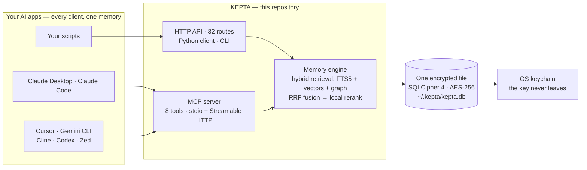
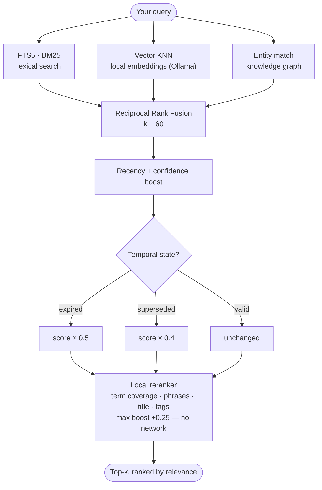

<p align="center"></p>
<p align="center">      <a href="https://www.linkedin.com/in/damian-todorovic-244235434"></a></p>

# KEPTA — the memory for AI systems

## Your AI forgets everything. Every chat starts from zero.

**KEPTA is the fix: one local, encrypted memory that every AI reads and writes — Claude, Cursor, Gemini CLI, Cline, any MCP client, and scripts over HTTP. No cloud. No account. One file you own.**

Everything an AI system learns goes into an encrypted knowledge base on your own computer — and every AI recalls it in milliseconds, however long the context grows. Documents, decisions, client knowledge, whole chat histories: remembered, linked, contradicted, superseded — never lost.

This repository is the **source-available core** (BUSL-1.1 — every line public, converts to AGPL-3.0-or-later four years after each release): the memory engine, the MCP server, the HTTP API — and the Python client, which is MIT so any Python project can embed it. **Everything that makes the memory smart lives in this free engine. There are no tiers inside the memory — nothing is held back to sell anything.**

Questions, security feedback or benchmark critique? → **[Discussions](https://github.com/DamianTodorovic/kepta/discussions)**



---

## ⚡ One command, every AI client

Needs **Node 22.13 or newer** (`package.json` → `engines`) on the machine you install on; npm has prebuilt SQLite binaries for Node 22, 24 and 26.

```bash
npx -y kepta-mcp demo          # six scenes in a throwaway database — nothing of yours is touched
npx -y kepta-mcp setup         # connects Claude Desktop, Claude Code, Cursor, Windsurf, VS Code, Gemini CLI, Cline and Roo Code
npx -y kepta-mcp remember "Client Miller signs renewals in December."   # write a note from the terminal, no AI client needed
npx -y kepta-mcp recall "who signs renewals"                            # read it back: 1 match — ranked by relevance
npx -y kepta-mcp stats         # size, encryption state, top tags
npx -y kepta-mcp timeline "miller"                                     # what was true, and when
npx -y kepta-mcp import chatgpt <export-folder>   # bring your ChatGPT history with you (export → extract → import)
```

What those two lines answer, verbatim — `kepta-mcp` 3.2.0 from the registry on 10.10.2026, a
throwaway `HOME`, an empty memory:

```text
$ npx -y kepta-mcp remember "Client Miller signs renewals in December."
✓ remembered — Client Miller signs renewals in December.
  type: semantic · id: k-mv2mghs9-fdf75c17

$ npx -y kepta-mcp recall "who signs renewals"
1 match — ranked by relevance

1. Client Miller signs renewals in December. · semantic · today
  Client Miller signs renewals in December.
  #remember
```

A **note** is one thing your memory holds — `remember` writes one by hand, your AI client writes the same kind through the `memory_save` tool. Then tell your AI something worth keeping — and watch it arrive. Details in the [Quick start](#-quick-start).

---

---

## 🖥️ Or download the desktop app

**The core has no window of its own: its interface is your AI client.** If you want a window, that is the free desktop app — same engine, same encrypted file, same key — and it is downloadable from the releases of this repository. For teams and organizations there is KEPTA Enterprise by agreement. These three sentences are the whole answer; every document here says the same.

The app brings the memory browser, hybrid search with retrieval provenance, the knowledge graph, time travel, dossiers and a chat that reads the memory. Download the DMG for your Mac from the [latest release](https://github.com/DamianTodorovic/kepta/releases/latest) (Apple Silicon or Intel) and drag it into Applications. The build is ad-hoc signed and not notarised, so macOS asks a single time. Two ways through, and both work on every macOS version: `xattr -dr com.apple.quarantine /Applications/KEPTA.app`, or **System Settings → Privacy & Security** → the KEPTA message → **Open Anyway**. Once, then never again. Older guides say right-click → *Open*; Apple removed that route in macOS 15 and it does nothing on current systems. (What runs from this repository has no window: `npm run dev` starts the HTTP API and its `POST /mcp` — a service on your machine, not an interface.)

The app is free, like everything in this repository. KEPTA Enterprise (team and tenant memory, audit chain, human review, point-in-time recovery) is licensed by agreement — [write to me on LinkedIn](https://www.linkedin.com/in/damian-todorovic-244235434).

## 🧠 One engine. Free. For every AI.

KEPTA is not a feature inside one app — it is a memory layer that outlives every model, every app and every context window. Three doors lead into the same encrypted file:

| Door | What uses it |
|---|---|
| **MCP** — 8 tools, stdio (npm binary and container) + Streamable HTTP (this repository, run from source) | Every MCP client: Claude, Cursor, Gemini CLI, Cline, Codex, Zed, your own agents |
| **HTTP API** — 32 routes, loopback only | Scripts, cron jobs, agent teams, automations |
| **Python** — `pip install kepta`, standard library only | Any Python project, embedded |

**Free means free:** €0, forever — no account, no licence key, no daily limit, no tier inside the memory, nothing locked to sell you later. The best memory engine we can build is the free one; that is the point. This sentence is about money, not about capacity. On one machine the local API stops accepting new notes once `KEPTA_MAX_ACTIVE` notes are active (**5000** by default, `server.ts` → `maxActiveMemories()`): a brake on a runaway agent writing your memory full, not a paywall — raise it with that variable and nothing else changes. Nothing in the free core is a locked feature; see [SECURITY.md](SECURITY.md#environment-variables) for every such screw.

**Teams and organizations** — shared team memory, central policies, MDM, organisation-wide audit — get **KEPTA Enterprise by request**. Coordination is the only thing we ever charge for; memory quality never is. → [write to me on LinkedIn](https://www.linkedin.com/in/damian-todorovic-244235434)

---

## ⚡ Quick start

### Connect your AI apps

```bash
npx -y kepta-mcp setup
```

Finds Claude Desktop, Claude Code, Cursor, Windsurf, VS Code, Gemini CLI, Cline and Roo Code on your computer and adds KEPTA to them. It asks per app (`--yes` connects all of them), keeps a backup of every file it changes and leaves every other entry alone. Zed, Codex CLI and Continue get the exact snippet to paste (their config formats move too fast to write from outside). Any other MCP client:

```json
{
  "mcpServers": {
    "kepta": {
      "command": "npx",
      "args": ["-y", "kepta-mcp"]
    }
  }
}
```

8 tools: `memory_search`, `memory_save`, `memory_update`, `memory_delete`, `memory_list`, `memory_graph`, `memory_consolidate`, `memory_forget`.

### HTTP API

```bash
git clone https://github.com/DamianTodorovic/kepta.git
cd kepta && npm install && npm run dev
# → http://127.0.0.1:3000

# save a note
curl -s localhost:3000/api/memory -H 'Content-Type: application/json' \
  -d '{"title":"Client Miller","content":"Billed quarterly.","tags":["client"]}'

# search
curl -s "localhost:3000/api/memories/search?q=how+does+miller+pay"
```

### Docker (MCP server only)

Build the image from a **clean clone, before any `npm install`** — a `node_modules` built for macOS that ends up in the build context breaks the Linux build (`ERR_DLOPEN_FAILED`). Measured both ways on 09.10.2026: the same `docker build -t kepta-mcp .` fails with 189 MB of context and succeeds with 19 MB from a clean clone. (`.dockerignore` now keeps `node_modules` and build artefacts out of the context; until it reaches your checkout, a clean clone is the safe route.)

```bash
git clone https://github.com/DamianTodorovic/kepta.git && cd kepta
docker build -t kepta-mcp .

# A container has no keychain, so the database key is not optional here: it has
# to come from the environment. Generate it ONCE and keep it — it is the only way
# back into the volume.
KEPTA_DB_KEY=$(openssl rand -hex 32)

docker run --rm -i -e KEPTA_DB_KEY="$KEPTA_DB_KEY" -v kepta-data:/data kepta-mcp
```

**No key, no file.** Pass a real value: 64 hexadecimal characters, `openssl rand -hex 32`, generated once and stored where you keep your secrets. A container cannot fall back to a keychain, so without `KEPTA_DB_KEY` a **new** knowledge base is not created — KEPTA stops with a non-zero exit and says what to do instead. The same value has to come back on every later start: a fresh `openssl rand -hex 32` the second time means a key that does not fit the volume, and that also stops with nothing changed. The only way to a plaintext database is the switch that says so out loud, `KEPTA_ENCRYPTION=off`.

One transitional sentence for whoever reads this against an older build: **before** this rule was in the code, an unusable value (a placeholder copied out of a guide, too short, not hex) did not fail — KEPTA printed one line, created the database in **plaintext** and exited 0. If your `kepta.db` starts with the bytes `SQLite format 3`, that is what happened, and the file is readable by anyone who can read it. Check the version, then re-key or replace the volume. [SECURITY.md](SECURITY.md#encryption-at-rest) has the whole rule.

### CI, servers and every other headless start

A CI runner has no keychain either, so the key comes in as a secret — generated **once**, not per job, or every run starts a fresh empty memory:

```yaml
# GitHub Actions, one step. The secret holds the 64 hex characters from `openssl rand -hex 32`.
- run: KEPTA_DB_KEY="${{ secrets.KEPTA_DB_KEY }}" npx -y kepta-mcp stats
```

Three traps, all measured on this repository:

- **An empty value is not "no key".** `KEPTA_DB_KEY=""` is dropped and the run goes looking in the keychain anyway — on your own machine that means it reads the keychain entry you did not mean to touch. Check that the variable is non-empty before starting, and do not let a templating mistake turn it into `""`.
- **A placeholder is a value too.** Copying a `<64-hex>`-style token out of any guide is the same case as an empty one.
- **A key in a logged command line is a published key.** Pass it through the environment file or the runner's secret mechanism, not through a shell history that CI prints.

If the run cannot reach a key at all, the correct outcome is the one above: no database, a non-zero exit, a sentence naming `KEPTA_DB_KEY`. A green CI that built a plaintext knowledge base is the failure this rule closes. The full variable list, with defaults and where each is read: [docs/ENVIRONMENT.md](docs/ENVIRONMENT.md).

---

## ✨ What's inside

| | |
|---|---|
| 🔍 **Hybrid search** | BM25 full text + vector similarity (Ollama) + knowledge graph, fused with RRF, with local reranking. The three legs are not three equal forces — the numbers this repository measures are under the diagram below |
| 🔐 **Encrypted at rest** | SQLCipher 4: AES-256 and an HMAC-SHA512 over every page, the WAL included; the key lives in the OS keychain (macOS Keychain, Windows DPAPI, Linux Secret Service) |
| 🕐 **Time travel** | Validity windows (`valid_from` / `valid_to`) and `asOf` queries — "what did I know on 3 March?" |
| ♻️ **Superseded, not contradicted** | New facts replace old ones (`superseded_by`); the history stays |
| 🔗 **MCP first** | 8 tools, one code path for the API and MCP — agents get the same quality as any client |
| 📄 **File import** | PDF (pdf.js with character maps), Markdown with `[[wiki links]]`, text, JSON |
| 📊 **Eval** | `npm run eval` on a fixed corpus of 58 notes / 45 queries: Hit@1, Recall@5 (capped), MRR — lexical only, offline, deterministic. Called *recall* on purpose: the script divides the hits inside the top five by `min(5, relevant)` (`scripts/eval.ts`, in `evaluate()`: `hitsIn5 / Math.min(5, Math.max(1, relevant.length))`), which measures how much of the answer set arrived, not how clean the five are. `npx tsx scripts/ablation.ts` measures each retrieval leg against the others on the same corpus with embeddings from a local Ollama, and its P@5 uses the shared denominator 5 (`scripts/ablation.ts:46`) — same notes, different metric, numbers not interchangeable |

### How a query finds its answer



**What each leg is worth on its own** — `npx tsx scripts/ablation.ts` on this state, 58 notes / 45 queries, local Ollama, re-measured on 09.10.2026: Hit@1 with **full text alone 71 %**, full text **+ graph 71 %** (+0 percentage points), full text **+ vectors 78 %**, **all three 78 %**; the graph leg alone reaches 11 %. Read that honestly: full text carries the answer, the vector leg is what adds the seven points and is the only leg that needs a model, and at this state the graph leg does not move the ranking of this corpus — it is there for entities and for `GET /api/graph`, not for the win. Claiming three equal strengths would sell a number the repository's own script contradicts.

---

## 🖥️ HTTP API (32 route paths)

32 distinct paths; counting each HTTP verb on its own they are 35 endpoints, because a path like `/api/memories`, `/api/settings` and `/mcp` answers two verbs. Both numbers come from `server.ts` itself, and `tests/doku-zahlen.test.ts` counts the paths — so a new verb on an existing path moves only the second number, a new path moves both.

| Area | Routes |
|---|---|
| Memories | `GET/POST /api/memories`, `POST /api/memory`, `DELETE /api/memories/:id`, `POST /api/memories/:id/restore`, `POST /api/memories/bulk-delete`, `POST /api/memories/bulk-restore`, `POST /api/memories/reclassify`, `POST /api/memories/import` |
| Search & graph | `GET /api/memories/search`, `POST /api/search`, `GET /api/graph`, `GET /api/graph/bild` |
| Import / export | `POST /api/import/markdown`, `POST /api/export/markdown` |
| Inbox | `GET /api/inbox/status`, `POST /api/inbox/scan` |
| Device Sync | `POST /api/sync/export`, `POST /api/sync/import`, `GET /api/sync/journal` |
| Encryption & repair | `GET /api/health` (including the `encryption` status), `POST /api/repair/imports` |
| MCP | `POST /mcp`, `GET /mcp`, `GET /api/mcp/tools`, `POST /api/mcp/search`, `POST /api/mcp/save`, `POST /api/mcp/consolidate`, `POST /api/mcp/forget`, `GET /api/tools`, `POST /api/embed` |
| System | `GET /api/settings`, `PUT /api/settings`, `GET /api/storage-info`, `GET /api/activity` |

Every route listens on `127.0.0.1` only, with rate limiting, Helmet and input validation.

This API is the server run **from this repository** (`npm run dev`, or `npm run build && npm start`). The published npm binary and the Docker container speak MCP over **stdio only** — `POST /mcp` answers here, not from `npx kepta-mcp`.

Loopback is the default, not a promise: setting `KEPTA_HOST` binds the same unauthenticated API to that address, and then every machine on the network can read and delete your memory. What to do instead of setting it is written in [SECURITY.md](SECURITY.md#environment-variables).

### What the API asks for before it destroys anything

Five behaviours a script has to know, all of them added because the old default was a data loss waiting for a typo:

- **`POST /api/memories/import` with `mode:"replace"` needs `confirm:"replace"`.** Without it the call answers `400` and nothing happens — the whole knowledge base used to go with it, permanently, on a one-line call. Before the purge the core writes an encrypted snapshot to `<data folder>/backup/kepta-pre-replace-<timestamp>.db` and names it as `backupPath` in the response. `dryRun: true` shows `affected: { active, trashed }` first and changes nothing. A payload that carries no usable note (an empty array, or notes without content) is refused with `400` — that was the case that erased everything. To restore: put the `.db` into an empty data folder as `kepta.db` and start with the same key. Those snapshots stay where they are, one per confirmed swap — cleaning up `backup/` is yours, not the core's.
- **`DELETE /api/memories/:id?permanent=` is strict.** Only `1`, `0`, `true`, `false`, or the parameter absent (= trash). Anything else, `True` included, is a `400` and deletes nothing; `?permanent=1&permanent=0` is a `400` too.
- **`GET /api/settings` no longer names secrets.** Keys ending in `key`, `api_key`, `token`, `secret`, `password`, `passwort`, `passphrase`, `schluessel` and the `ai_settings` blob come back as `{ gesetzt: true, ende: "…last four characters…" }` — under eight characters there is no `ende`, and a deleted entry is gone from the answer. Writing stays on `PUT`; the full value stays inside the encrypted database. Show `gesetzt` + `ende` in any UI, never the value.
- **Error answers are JSON.** No stack trace, no absolute paths, no echo of the body you sent. `413` names the boundary and what arrived (`limitBytes`, `receivedBytes`), a broken body gets a `400` without repeating itself, and from `500` up the real reason goes to the server log instead of the response.
- **`POST /api/repair/imports` accepts 16 kb.** The limit was declared before and never applied (900 KB went through); now anything larger ends in `413`. Nothing else on this route changed.

Two smaller ones worth a line each: a **symlink inside `~/.kepta/inbox/` is not imported** — it stays where it is, and `POST /api/inbox/scan` reports it in `skipped: [{ file, reason }]` (a link was enough to pull any readable file of yours into the memory an agent sees). And **`GET /api/graph` is capped**: up to 500 entities and 2000 relations (`src/core/store.ts`, `getGraph()`), with no `ORDER BY` in front of either cap — which ones come back is decided by row order, not by importance, so a central term can be missing from a big store. One thing those edges do **not** bring: the relations in the answer carry `validFrom` and `validTo`, but the core's own write path leaves both empty (`addRelation` is called without a window, so the default `null` stands). A client drawing this graph cannot tell an expired claim from a live one and must not pretend it can.

### GET /api/graph/bild — the one that says what it cut

`GET /api/graph` stays exactly as it is, because outside agents write against its shape. The picture route is the honest sibling: it answers the contract `graf-2` with `sicht`, `entitaet`, `tiefe`, `knoten`, `kanten`, `layout` — and **no** `width`/`height`, on purpose. Positions come in **world units** (`welt.groesse = 1000`, `src/core/graf-vertrag.ts`), the client scales by `min(width, height) / 1000`, so a window size never enters a layout calculation. What it computed is not what it shows, and the answer says so itself in `kuerzung`: the caps it honoured, what is left over (`uebrig`), **why** it cut (`grund`: `knoten`, `kanten`, `paarBudget`, `tiefe`, `privat`, `papierkorb`), how many private and trashed carriers were filtered — numbers, never names — which nodes and edges are orphaned, and a single `vollständig` flag. ETag and `If-None-Match` give a `304` without recomputing. If a client needs to know whether the picture is the whole store, that is the field to read; `GET /api/graph` does not tell you.

---

## 🐍 Python client

A running KEPTA on this machine is the precondition: the desktop app, or `npm run dev` in this repository. `pip install kepta` brings the client, never a server — and note that `npx kepta-mcp`, the stdio server your AI client starts, opens **no HTTP port at all**, so it is not what this client talks to.

```bash
pip install kepta
```

```python
from kepta import KeptaClient
kepta = KeptaClient()
kepta.save("Carbonara", "Guanciale, pecorino, egg yolk. No cream.", tags=["cooking"])
for hit in kepta.search("carbonara without cream"):
    print(f"{hit.score:.2f}  {hit.memory.title}")
```

No dependencies — only the Python standard library.

The example above is measured, not decorative: `search("carbonara without cream")` ranks that note first, vector similarity 0.75 on the default model (`nomic-embed-text`). What the same model does **not** do is find a paraphrase that shares no word with the note: `search("what do I cook with pasta")` leaves the recipe at 0.51, under the vector floor of 0.58 (`src/core/engine.ts`, `VECTOR_FLOOR`), while a note that merely contains the word "Pasta" wins at 0.59. Full text is the leg that answers in that case — it matches the one word the question and the note do share. [python/README.md](python/README.md#how-search-works) names the limit and what it takes to move it.

---

## 🏗️ Architecture

```
src/core/           memory engine (store, search, encryption, MCP protocol)
server.ts           HTTP API (Express, 32 routes)
src/mcp-server.ts   MCP stdio server (npx kepta-mcp) and the CLI (npx kepta-mcp)
src/ui/graph.ts     the graph builder behind the CLI and the demo — `GET /api/graph` reads `store.getGraph` directly instead. No UI: the core has no window of its own, the interface is your AI client, and for a window there is the free desktop app in this repository's releases
npm/                source of the npm package (kepta-mcp)
Dockerfile          container for the MCP server
python/             Python client (PyPI: kepta)
scripts/            eval, benchmark, repair
tools/              benchmark harnesses (LongMemEval, latency)
docs/               environment variables and the words the API uses
tests/              Vitest suite with CI-enforced coverage thresholds
```

**One code path** for the HTTP API and the MCP server — agents get the same results as direct API calls.

---

---

## 🔧 Screws

Every variable KEPTA reads from the environment — with its default, what it changes and what
can break if you touch it — is in one table: **[docs/ENVIRONMENT.md](docs/ENVIRONMENT.md)**. The
three that matter most, in short:

| | |
|---|---|
| `KEPTA_MAX_ACTIVE` | how many active notes the local API accepts (default **5000**) before it answers `429`. Not a licence limit — a brake on a runaway agent. Raise it and nothing else changes. |
| `KEPTA_HOST` | bind address, default `127.0.0.1`. A network address here opens an **unauthenticated** API to that network and ends the loopback guarantee; use a reverse proxy with its own auth instead. |
| `KEPTA_ENCRYPTION` | `off` writes the database in **plaintext**, without asking twice. A tool for scripts that need raw SQLite — never the way to fix a key problem. |

The words the API and these documents use — note, memory, scope, `dry-run`, supersede, the two
meanings of *key* and *restore* — are explained once in **[docs/WORDS.md](docs/WORDS.md)**.

## 🔐 Encryption

The knowledge base is a SQLCipher 4 database: AES-256, an HMAC-SHA512 over every page, the WAL included. The key — 256 random bits — lives in the operating system's keychain: the macOS Keychain, Windows DPAPI or the Linux Secret Service. On servers and containers without a keychain, set `KEPTA_DB_KEY` to 64 hexadecimal characters — generate it once with `openssl rand -hex 32` and keep it.

What that means on the byte level, measured rather than asserted: one note written with `kepta-mcp` 3.2.0 from the registry into a throwaway `HOME` on 10.10.2026 left a `~/.kepta/kepta.db` whose first sixteen bytes are `85 95 55 36 a3 ab f4 02 4c 6c f0 5c 0f 0b 4c 69` — not `SQLite format 3` — with no trace of the note's text anywhere in the file. `head -c 16 ~/.kepta/kepta.db` is the whole test, on any store, yours included.

**The rule: no key, no file.** When KEPTA is about to create a knowledge base and cannot put its key somewhere safe — no keychain, a denied approval, CI with an empty environment — it does **not** create the file. It stops with a non-zero exit and names the way out (`KEPTA_DB_KEY`, or `KEPTA_ENCRYPTION=off` if plaintext is truly what you want). Failing quietly into an unencrypted database was the old behaviour, and it is the failure this rule exists to kill. Opening an **existing** file is unchanged: a missing or wrong key there already stopped and changed nothing. *Standing date: this was decided on 10.10.2026 and is being put into the code now — a build that predates it still writes plaintext and exits 0 on an unusable value, so if you run an older release, test it rather than trusting this sentence.*

That leaves exactly one door to plaintext, and it is a door you have to open on purpose: **`KEPTA_ENCRYPTION=off`**. It is for tooling that must read raw SQLite — inspectors, one-off migration scripts — not a performance switch, and not a fix for a key problem (on an encrypted file it produces an unreadable-file error instead). Never reach for it to get a container started; that is the case `KEPTA_DB_KEY` is for. What the encryption covers, what it cannot cover, and how to keep a copy of the key: [SECURITY.md](SECURITY.md).

---

## 🧪 Quality

**982 tests** (measured 2026-10-11) with Vitest and v8 coverage — the number of cases a run actually executed, skipped ones not included. `npm test` writes that run's JSON report, and `node scripts/doku-check.mjs` then holds both READMEs to exactly that number. `tests/doku-zahlen.test.ts` listens to the same report and refuses to compare when it cannot be trusted — missing, older than the suite, or written by a partial run — instead of checking a value out of the drawer. The coverage thresholds are a CI gate: a commit that falls below one of them turns CI red. On top: a retrieval eval (Hit@1, Recall@5 capped, MRR) on a fixed corpus, an ablation test per retrieval leg, an encryption eval and a boundary test on the core architecture.

### Coverage thresholds (enforced by CI)

| Area | Lines | Functions | Branches | Statements |
|---|---|---|---|---|
| together, inside the coverage scope | **70 %** | **72 %** | **56 %** | **66 %** |
| `src/core` | **87 %** | **89 %** | **74 %** | **85 %** |

Measured scope is `src/core/**` plus `server.ts` (`vitest.config.ts`) — the headless
core, which is the product. `tools/`, `scripts/`, `npm/` and `python/` have their own
suites but no threshold, so they are not inside these percentages.

### Latency — measured, public

Median search times on one laptop (Apple M4), every run committed in [`tools/latenz/ergebnisse/`](tools/latenz/ergebnisse/): **46.6 ms** median at 100,000 memories (p95 87.6 ms), **276.5 ms** median at **1,000,000 memories**. Three conditions sit in the records themselves and belong with the numbers, not under them. The runs measure the engine with encryption switched off and a deterministic stub embedder — `konfiguration.verschluesselung` and `konfiguration.embedder` say so. And `konfiguration.vektorChunks` is **20000 in both**: `tools/latenz/bench.ts:38` pins the vector leg to `min(20_000, N)`, so the million-memory median was measured with the same 20,000 chunks as the 100,000 one — a bounded vector leg, not a fully embedded store of that size. A store where every note carries its vectors searches slower than this one number suggests; how much slower is a measurement this repository has not published yet, and `tools/latenz/README.md` states the 20,000-chunk condition where the runs are listed. The file on disk is always SQLCipher-4 encrypted; the crypto cost is just not inside these two medians.

### Benchmark record — LongMemEval-S, fully public

KEPTA ships its memory benchmark as raw per-question records instead of a headline number: **every run commits all 500 question records to this repository**, in [`tools/longmemeval/ergebnisse/`](tools/longmemeval/ergebnisse/) — each with its id, type and skill, the judge's verdict, how many notes retrieval returned, which of the retrieved contexts settled it, and whether the reference answer appeared verbatim. The question and answer *text* is not in the repo: it comes from the pinned upstream dataset, whose SHA-256 every record carries. Fixed dataset (LongMemEval-S, 500 questions, SHA-pinned), fixed judge, fully reproducible locally — see [`tools/longmemeval/README.md`](tools/longmemeval/README.md).

The series is committed as raw per-question records — and it is **not a current measurement**, which is why no score is quoted here. Every record in that folder names a `kepta_version` between **2.13.2 and 2.13.22** (`grep -h kepta_version tools/longmemeval/ergebnisse/*.json`), while this repository ships **3.3.0**. Until the chain runs again against the shipped engine, the numbers stay in the records and out of the paper. What does not change: both judges are local (`qwen2.5:3b` for the continuity series, `qwen2.5:14b` Q4 for the later runs, both on a consumer GPU), zero cloud, no fine-tuning, and every step of both chains is a run record in the same folder.

**What the metric measures — read this before comparing it to anyone else's.** It is **context sufficiency**, not end-to-end answer accuracy: a local judge (qwen2.5:14b, temperature 0, prompt v1) grades whether the *retrieved contexts* contain the reference answer. There is no generator LLM in the loop, a `PARTIAL` verdict counts as half a point, and 29.8 % of the questions in that run were settled by a deterministic verbatim match without any judge call at all. Zep's published 63.8 % is answer accuracy of a full generation pipeline judged by a cloud LLM — related evidence, **not the same metric**. And one more caveat, stated plainly: every lever in the series (topk, `--temporal`, `--zeitsplit`, HyDE, judge size) was selected on these same 500 questions, so the series figure is an in-sample one, biased upward; an untouched holdout split has not been run yet. The raw per-question records are the point of publishing all this — check us, including this framing.

---

## 👋 Who builds KEPTA

KEPTA is built by **Damian Todorovic** and **Emil Wagner** — a small team from Germany, shipping in public. Questions, ideas, Enterprise for your team — or you simply want to follow where this is going: **[find us on LinkedIn](https://www.linkedin.com/in/damian-todorovic-244235434)**.

## 📄 License

[BUSL 1.1](LICENSE) — source-available, not OSI-approved open source: every line public, production use inside your own organization always allowed, offering it as a hosted service is reserved, and each version converts to AGPL-3.0-or-later four years after release. **The npm package `kepta-mcp` carries the same license as this repository; the Python client under `python/` stays MIT** so any Python project can embed it. KEPTA Enterprise for teams and organizations is licensed by agreement — [write to me on LinkedIn](https://www.linkedin.com/in/damian-todorovic-244235434).

**What this repository is — and what it is not.** This source-available core is the memory engine: storage, retrieval, MCP — free, for every AI. Forks are legitimate; presenting a fork as KEPTA is not: the **KEPTA name and the KEPTA branding belong to Damian Todorovic**. Fork it, build with it, ship your own product from it — under a different name, without offering this engine as a hosted service, and with every change you make becoming AGPL-3.0-or-later when the version's Change Date arrives. Private notes stay out of every AI channel — `private` is a disclosure rule toward agents, not a shield against programs running on your own machine ([SECURITY.md](SECURITY.md)).

---

<p align="center">
  <sub>KEPTA — the best place to store knowledge for AI. Local, encrypted, free. No subscription, no account, no excuses.</sub>
</p>
